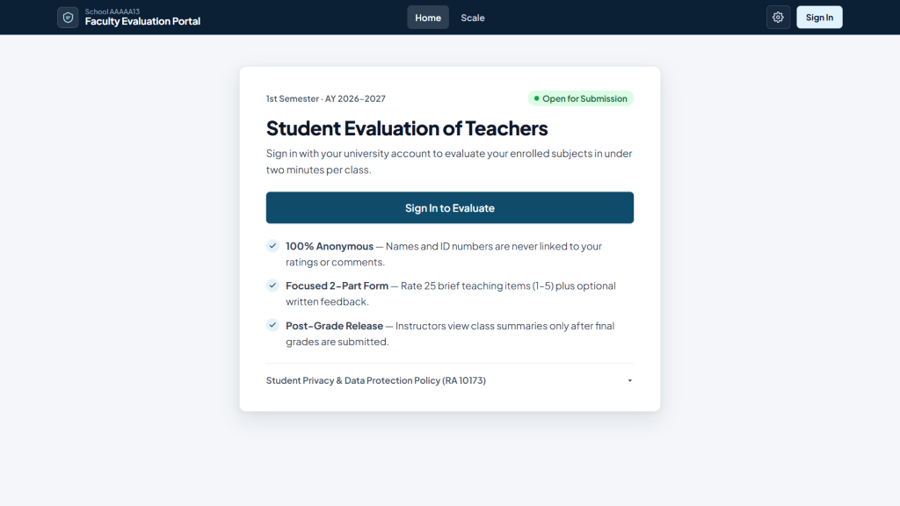
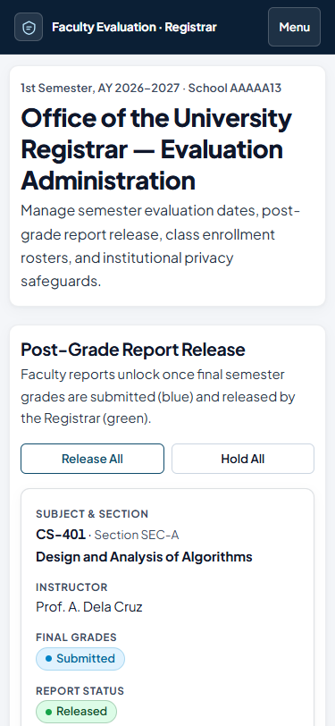

# School AAAAA13 — EvaluaTech

> **Automated Student Evaluation of Teachers (SET) Platform Combining Memory-Safe Rust Systems (`evaluatech-server` + `evaluatech-web` WASM) with Python Multilingual NLP & Machine Learning (`calamanCy` + `vaderSentiment` + `scikit-learn`), Role-Tailored Navigation, and Dual-Token Cryptographic Decoupling.**

[%5D)-dea584.svg?style=flat-square)](Cargo.toml)
[-3776ab.svg?style=flat-square)](nlp-python/)
[](evaluatech-web/)
[](evaluatech-server/src/security.rs)
[](web-dist/styles.css)

---

## 1. Overview & Polyglot Architecture

**EvaluaTech** separates systems engineering from machine learning using the right language for each domain:
- **Safe Rust (`evaluatech-server`, `evaluatech-web`, `evaluatech-nlp`)**: Memory-safe HTTP/SQLite persistence, cryptographic Dual-Token student anonymity, 63 OWASP controls, Likert $(\mu, \sigma^2)$ descriptive arithmetic, and WebAssembly UI rendering.
- **Python (`nlp-python/`)**: Genuine **`calamanCy` + `spaCy`** Tagalog/Taglish morphological tokenization & lemmatization, **`vaderSentiment`** multilingual polarity scoring, and **`scikit-learn`** Dual-Regime Logistic Regression sentiment & 5-cluster pedagogical classification.

| Component | Language / Target | Responsibility |
| :--- | :--- | :--- |
| [`nlp-python`](nlp-python/) | Python 3.12 (`calamanCy`, `spaCy`, `vaderSentiment`, `scikit-learn`, `FastAPI`) | Multilingual English / Tagalog / Taglish sentiment & pedagogical cluster ML pipelines (`models/*.joblib`), `calamanCy` lemmatization, VADER valence, batch summarization, and FastAPI / warm JSON-RPC worker execution. |
| [`evaluatech-web`](evaluatech-web/) | Rust `cdylib` (`wasm32-unknown-unknown`) | Role-tailored institutional SPA: **Plain distraction-free webpage** for Students (`/queue`, `/evaluate/:id`) with zero global scale clutter, paired with a structured **Institutional Left Sidebar** for Professors, Department Chairs, College Deans, and University Registrar Officers (`/faculty`, `/chair`, `/dean`, `/admin`). |
| [`evaluatech-server`](evaluatech-server/) | Safe Rust Binary (`evaluatech-server`) | Standalone **Axum + Tokio + SQLite WAL** server bridging to `nlp-python` and enforcing `EVT.*` HMAC-SHA256 Bearer auth, one-time temporary credentials (`TMP-*`), Dual-Token Cryptographic Decoupling, `FT-02` idempotency, Double-Blind faculty grade locks, and AACCUP Level III dossier sealing (`AAAAA13-AACCUP3-*`). |
| [`evaluatech-nlp`](evaluatech-nlp/) | Safe Rust `rlib` | Shared non-ML Likert 25-item descriptive statistics, CSV formula sanitization, and defense-in-depth PII scrubbing. |

---

## 2. Institutional Portal Walkthrough

| University Home Portal (`/`) | Student Profile Dashboard (`/queue`) |
| :---: | :---: |
|  |  |

| 2-Part Evaluation Form (`/evaluate/:id`) | College Dean Portal (`/dean`) |
| :---: | :---: |
|  |  |

| Registrar Administration (`/admin`) | Mobile `375×812` Card-Stacked Layout |
| :---: | :---: |
|  |  |

---

## 3. Core Institutional & Cryptographic Invariants

- **Dual-Token Cryptographic Decoupling**: Enrollment completion records (`evaluation_clearances`) are physically separated from anonymized evaluation sheets (`evaluation_vault`). `evaluation_vault` stores **zero** `student_id`, `user_id`, `clearance_id`, IP address, session ID, or sub-second correlation timestamps.
- **FT-02 Concurrency & Idempotency**: Submissions verify `submission_key` inside atomic SQLite transactions, ensuring retries or double clicks return the original receipt (`CLR-*`) without inserting duplicate responses.
- **Double-Blind Faculty Release Gate**: Instructors receive `HTTP 403 DOUBLE_BLIND_LOCKED` until both `term_grades_submitted = true` and `registrar_lock = true` are satisfied.
- **Scoped Academic Follow-Up Containment**: Scoped participation endpoints (`GET /api/{chair,dean,admin}/participation`) list pending students strictly from enrollment and completion ledgers for polite academic follow-up without touching `evaluation_vault`.
- **One-Time Temporary Credentials**: Roster imports issue CSPRNG temporary passwords (`TMP-*`) stored strictly as bcrypt with `must_change_password = 1`, pinning accounts to `/account/password` until rotated.

---

## 4. Multilingual Machine Learning Benchmarks (`nlp-python/`)

Trained and validated in **Python 3.12** across **`10,548` zero-leakage training samples** combining [`dev_partition.csv`](docs/analysis/dev_partition.csv) (`7,000`), [`expanded_training_corpus.csv`](nlp-python/data/expanded_training_corpus.csv) (`1,185`), and **`2,363` authentic human-written rows imported from 5 Hugging Face corpora** (`yhua219/EduRABSA_SA+ACD`, `jjjardev/tagasenti`, `Z-H-Che/ratemyprofessors-reviews-3-labels`, `kkotkar1/course-reviews`, and `chillies/course-review-multilabel-sentiment-analysis`; [`EXTERNAL_DATASETS_REPORT.md`](docs/analysis/EXTERNAL_DATASETS_REPORT.md)) using pretrained **`calamanCy` (`tl_calamancy_md-0.2.0`, `200d`)**, **`spaCy` (`en_core_web_md`, `300d`)**, **`vaderSentiment`**, and a **Specialist–Generalist 4-Head `scikit-learn` Ensemble**. Unaltered blind holdout performance on [`test_partition.csv`](docs/analysis/test_partition.csv) ([`MODEL_COMPARISON_REPORT.md`](docs/analysis/MODEL_COMPARISON_REPORT.md)):

| Metric (`n = 228` Untouched Blind Authentic Student Comments) | Score |
| :--- | :---: |
| **Authentic-Comment 5-Fold Out-of-Fold CV (`n = 572` Dev)** | **96.85%** (`0.9568` Macro F1, `99.55%` Neg Recall) |
| **Blind Held-Out Sentiment Accuracy (`n = 228` Test)** | **92.54%** (`211 / 228`, `0.9126` Macro F1) |
| **Negative Sentiment Recall (`n = 89` Neg)** | **93.26%** (`96.51%` Precision, `0.9486` Neg F1) |
| **Taglish / Tagalog / English Blind Accuracy** | **93.75%** / **92.59%** / **91.49%** |
| **Full `3,000`-Row Test Sentiment / Domain Accuracy** | **95.70%** Sentiment · **98.97%** Pedagogical Domain |
| **Warm Python IPC Worker Inference** | Persistent UTF-8 JSON-RPC (`evaluatech-server/src/python_nlp.rs`) |

---

## 5. Quick Start & Verification

### Train & Verify the Python `calamanCy` + Multi-Corpus `scikit-learn` ML Engine
```powershell
.\.venv\Scripts\python.exe -u nlp-python\build_expanded_corpus.py
.\.venv\Scripts\python.exe -u nlp-python\import_external_datasets.py
.\.venv\Scripts\python.exe -u nlp-python\train_model.py
$env:PYTHONPATH = "$PWD\nlp-python"
.\.venv\Scripts\python.exe -m pytest nlp-python\tests -v
```

### Run the Full-Stack Server (`http://127.0.0.1:8080`)
```powershell
cargo run -p evaluatech-server --release
```
*(Or double-click `START-EVALUATECH.bat` on Windows. `evaluatech-server` automatically spawns the warm `.venv` Python `calamanCy` worker.)*

### Rebuild the WebAssembly Frontend Bundle
```powershell
cargo build -p evaluatech-web --target wasm32-unknown-unknown --release
wasm-bindgen "target/wasm32-unknown-unknown/release/evaluatech_web.wasm" --out-dir "web-dist/pkg" --target web --no-typescript
```

### Run Strict Zero-Unsafe Lints & Automated Test Suite
```powershell
cargo fmt --all --check
cargo clippy --workspace --all-targets --all-features -- -D warnings
cargo test --workspace --all-features
```

---

## 6. Documentation

- [Institutional System Architecture](docs/INSTITUTIONAL_SYSTEM_ARCHITECTURE.md)
- [Architecture Decision Records (`ADR-001`–`ADR-008`)](docs/ARCHITECTURE_DECISIONS.md)
- [Domain-to-Rust Module Glossary](docs/GLOSSARY.md)
- [Production Deployment Guide](docs/PRODUCTION_DEPLOYMENT.md)
- [Managed Campus Laboratory Kiosk Guide](docs/MANAGED_KIOSK_DEPLOYMENT.md)
- [UI/UX Audit & Anti-Slop Modernization Specification](docs/ui_ux_audit.md)
- [Multilingual ML Model Comparison Report](docs/analysis/MODEL_COMPARISON_REPORT.md)
- [External Hugging Face NLP Datasets Curation Report](docs/analysis/EXTERNAL_DATASETS_REPORT.md)
- [Dataset Annotation Guidelines](docs/analysis/ANNOTATION_GUIDELINES.md)
