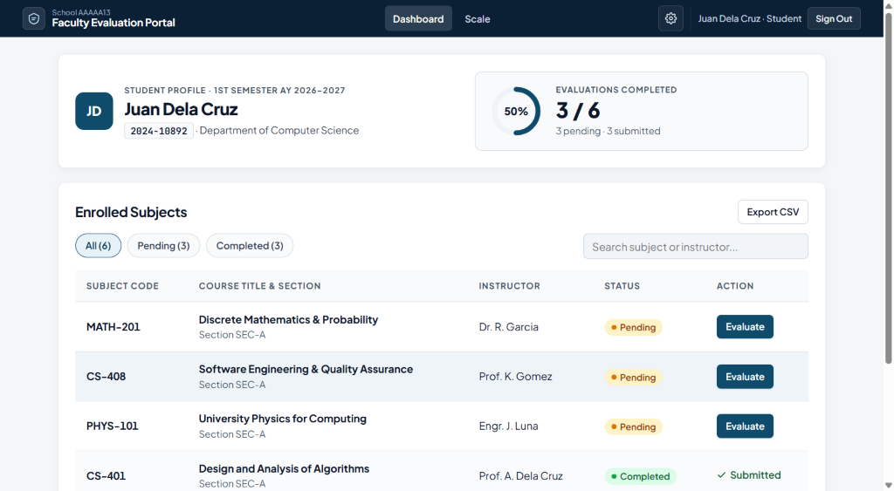
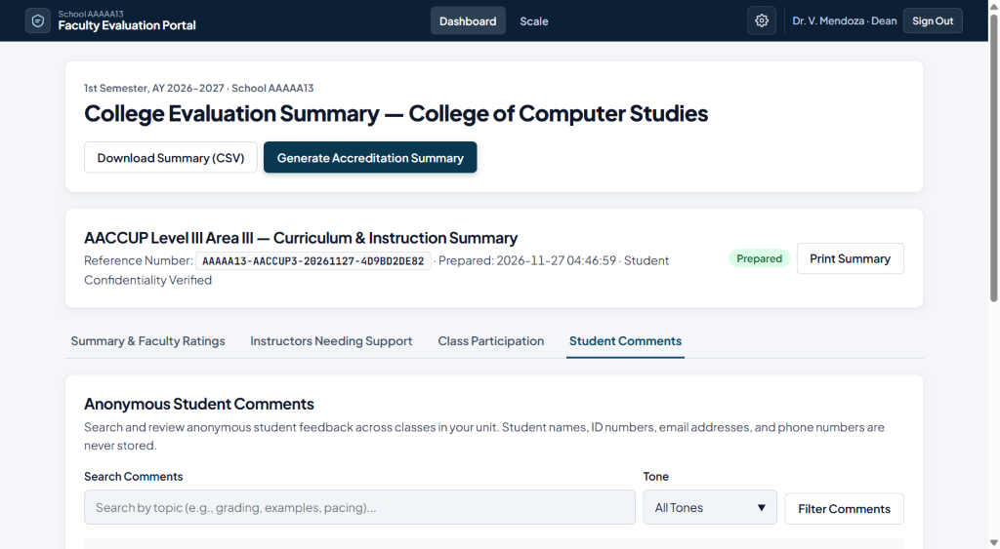

# School AAAAA13 — EvaluaTech

> **100% Pure-Rust + WebAssembly Automated Student Evaluation of Teachers (SET) Platform with Dual-Token Cryptographic Decoupling, 92.51% Multilingual Sentiment Analytics, Academic Document Sheet UI, and AACCUP Level III Governance.**

[%5D-dea584.svg?style=flat-square)](Cargo.toml)
[](evaluatech-web/)
[-92.51%25-blue.svg?style=flat-square)](docs/analysis/MODEL_COMPARISON_REPORT.md)
[](docs/analysis/MODEL_COMPARISON_REPORT.md)
[](evaluatech-nlp/)
[](evaluatech-server/src/security.rs)
[](web-dist/styles.css)

---

## 1. Overview & Architecture

**EvaluaTech** is an institutional faculty evaluation, cryptographic participation tracking, and multilingual natural language analytics platform built end-to-end in **100% safe Rust (`#![forbid(unsafe_code)]`)** and **WebAssembly (`wasm32-unknown-unknown`)** for **School AAAAA13**.

| Crate | Target | Responsibility |
| :--- | :--- | :--- |
| [`evaluatech-nlp`](evaluatech-nlp/) | `rlib` + `evaluatech-nlp-server` (`x86_64` & `wasm32`) | Multilingual English / Tagalog / Taglish sentiment & topic engine combining `calamanCy`-inspired Tagalog morphology, VADER polarity ($P \in [-1.0, +1.0]$), the **Neuro-Symbolic Dual-Regime Ensemble** (`models/ml_weights.json`), 5 pedagogical clusters + `Unclassified / Needs Review` facility isolation, Likert $(\mu, \sigma^2)$ variance math, and automatic PII redaction. |
| [`evaluatech-web`](evaluatech-web/) | `cdylib` (`wasm32-unknown-unknown`) | Pure-Rust WebAssembly SPA (`web-dist/pkg/evaluatech_web_bg.wasm`) delivering a focused, `topcit.or.kr`-inspired institutional UI across all five roles (`student`, `faculty`, `chair`, `dean`, `admin`) with an immediate post-login **User Profile Dashboard** (SVG progress ring + pending tasks), minimalist `52px` masthead with consolidated Settings gear dropdown (`A+ Large Text` & `Dark View`), inline scale tooltips, and zero-scroll `375×812` stacked mobile cards. |
| [`evaluatech-server`](evaluatech-server/) | Single Native Binary (`evaluatech-server`) | Standalone **Axum + Tokio + SQLite WAL** full-stack web & REST server embedding `web-dist/` directly into a single executable and enforcing `EVT.*` HMAC-SHA256 Bearer auth, one-time temporary credentials (`TMP-*`), Dual-Token Cryptographic Decoupling, `FT-02` submission idempotency, Double-Blind faculty grade locks, scoped Chair/Dean containment, AACCUP Level III dossier sealing (`AAAAA13-AACCUP3-*`), and 63 OWASP controls. |

---

## 2. Institutional Portal Walkthrough

| University Home Portal (`/`) | Student Enrolled Subjects (`/queue`) |
| :---: | :---: |
|  |  |

| 2-Part Evaluation Form (`/evaluate/:id`) | College Dean Portal & `A+ Large Text` (`/dean`) |
| :---: | :---: |
|  |  |

| Registrar Administration (`/admin`) | Mobile `375×812` Card-Stacked Layout |
| :---: | :---: |
|  |  |

---

## 3. Core Institutional & Cryptographic Invariants

- **Dual-Token Cryptographic Decoupling**: Enrollment completion records (`evaluation_clearances`) are physically separated from anonymized evaluation sheets (`evaluation_vault`). `evaluation_vault` stores **zero** `student_id`, `user_id`, `clearance_id`, IP address, session ID, or sub-second correlation timestamps.
- **FT-02 Concurrency & Idempotency**: Submissions verify `submission_key` inside atomic SQLite transactions, ensuring retries or double clicks return the original receipt (`CLR-*`) without inserting duplicate responses.
- **Double-Blind Faculty Release Gate**: Instructors receive `HTTP 403 DOUBLE_BLIND_LOCKED` until both `term_grades_submitted = true` and `registrar_lock = true` are satisfied.
- **Scoped Academic Follow-Up Containment**: Scoped participation endpoints (`GET /api/{chair,dean,admin}/participation`) list pending students strictly from enrollment and completion ledgers for polite academic follow-up without touching `evaluation_vault`.
- **One-Time Temporary Credentials**: Roster imports issue CSPRNG temporary passwords (`TMP-*`) stored strictly as bcrypt with `must_change_password = 1`, pinning accounts to `/account/password` until rotated.

---

## 4. Multilingual Machine Learning Benchmarks (`evaluatech-nlp`)

Trained on 10,000 collegiate statements across English, Tagalog, and Taglish (`800` authentic student comments + `9,200` synthetic statements, split 70/30 into [`dev_partition.csv`](docs/analysis/dev_partition.csv) and [`test_partition.csv`](docs/analysis/test_partition.csv)). Headline performance is reported **strictly on the 227 blind real held-out student comments** ([`MODEL_COMPARISON_REPORT.md`](docs/analysis/MODEL_COMPARISON_REPORT.md)):

| Metric (`n = 227` Blind Real Student Comments) | Score |
| :--- | :---: |
| **Real-Comment 5-Fold CV Accuracy (`n = 572`)** | **92.66%** (`0.9193` Macro F1) |
| **Blind Held-Out Sentiment Accuracy (`n = 227`)** | **92.51%** (`210 / 227`, `0.9019` Macro F1) |
| **Negative Sentiment Recall (`n = 89` neg)** | **94.38%** (`84 / 89`) |
| **Taglish / Tagalog / English Accuracy** | **95.00%** / **94.44%** / **89.25%** |
| **Pedagogical Cluster Accuracy (5 Clusters + Unclassified)** | **88.55%** (`0.7340` CV Macro F1) |
| **Pure-Rust Inference Latency** | **~15 µs / comment** |

---

## 5. Quick Start & Verification

### Run the Full-Stack Single-Binary Server (`http://127.0.0.1:8080`)
```powershell
cargo run -p evaluatech-server --release
```
*(Or double-click `START-EVALUATECH.bat` on Windows. When `APP_ENV=local` and the SQLite database is empty, demo accounts for `student`, `faculty`, `chair`, `dean`, and `admin` are seeded automatically.)*

### Rebuild the WebAssembly Frontend Bundle
```powershell
cargo build -p evaluatech-web --target wasm32-unknown-unknown --release
wasm-bindgen "target/wasm32-unknown-unknown/release/evaluatech_web.wasm" --out-dir "web-dist/pkg" --target web --no-typescript
```

### Run Strict Zero-Unsafe Lints & Automated Test Suite
```powershell
cargo fmt --all --check
cargo clippy --workspace --all-targets --all-features -- -D warnings
cargo test --workspace --all-features
```

---

## 6. Documentation

- [Institutional System Architecture](docs/INSTITUTIONAL_SYSTEM_ARCHITECTURE.md)
- [Architecture Decision Records (`ADR-001`–`ADR-008`)](docs/ARCHITECTURE_DECISIONS.md)
- [Domain-to-Rust Module Glossary](docs/GLOSSARY.md)
- [Production Deployment Guide](docs/PRODUCTION_DEPLOYMENT.md)
- [Managed Campus Laboratory Kiosk Guide](docs/MANAGED_KIOSK_DEPLOYMENT.md)
- [UI/UX Audit & Anti-Slop Modernization Specification](docs/ui_ux_audit.md)
- [Multilingual ML Model Comparison Report](docs/analysis/MODEL_COMPARISON_REPORT.md)
- [Dataset Annotation Guidelines](docs/analysis/ANNOTATION_GUIDELINES.md)
