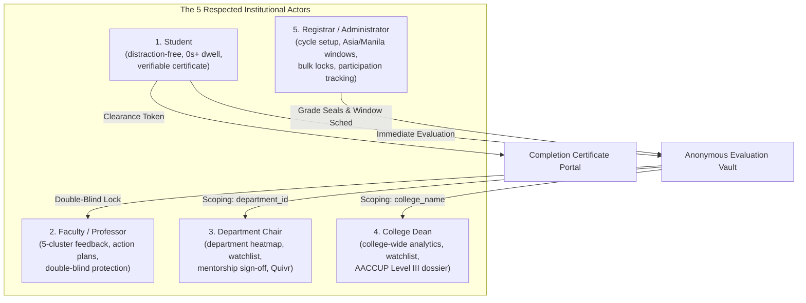

# School AAAAA13 — EvaluaTech Institutional System Architecture & Operational Manual

**Platform:** EvaluaTech / EvaluaTech
**Governance Standard:** AACCUP Level III (Area III: Curriculum and Instruction) & CHED CMO 46 Institutional Quality Assurance
**Legal Framework:** Republic Act No. 10173 (Data Privacy Act of 2012)
**Security Architecture:** 63-Control OWASP Defense-in-Depth & Dual-Token Cryptographic Decoupling
**Language Intelligence:** `calamanCy` Filipino/Taglish Morphological Pipeline + VADER Sentiment Polarity ($[-1.0, +1.0]$)
**Document Revision:** 3.0.0 (Authoritative Institutional Edition)

---

## 1. Executive Summary & Institutional Mission

School AAAAA13 is an esteemed local government university dedicated to academic excellence, social transformation, and continuous quality improvement. **EvaluaTech** is the official institutional student evaluation of teachers (SET) platform engineered for the university.

The system replaces legacy, coercive paper evaluation methods with a privacy-preserving, cryptographically decoupled digital architecture. EvaluaTech guarantees complete student anonymity, eliminates artificial answering gates, enforces double-blind grading integrity, and provides deep natural language feedback synthesis across the university's colleges and departments.

### The Institutional Zero Permits Policy
**School AAAAA13 strictly operates under a Zero Permits Policy.** Examination permits are never issued, mandated, or gated behind student evaluations. Evaluation is a formative academic instrument for instructional excellence, not an administrative barrier to student examination rights.

Instead, the platform implements **Institutional Evaluation Participation Tracking**:
1. Identifies students who have completed or have pending evaluations in the active term.
2. Reports progress by course section, department, and college without ever exposing or linking student identities to submitted ratings or written comments.
3. Issues an official **Digital Evaluation Completion Certificate** verifying the student has fulfilled their institutional civic contribution.

---

## 2. Core Architectural Invariants

### 2.1 Dual-Token Cryptographic Decoupling
To defeat correlation attacks and guarantee zero retaliation under RA 10173, EvaluaTech physically isolates identifiable participation records from anonymous evaluations across two decoupled databases:

```
┌─────────────────────────────────┐           ┌─────────────────────────────────┐
│     EVALUATION CLEARANCES       │           │        EVALUATION VAULT         │
├─────────────────────────────────┤           ├─────────────────────────────────┤
│ • clearance_id                  │           │ • vault_id                      │
│ • student_id (User FK)          │           │ • course_section_id             │
│ • course_section_id             │           │ • academic_term_id              │
│ • signed_clearance_token        │           │ • 25 Likert ratings (5 clusters)│
│ • completed_at                  │           │ • scrubbed qualitative comments │
│                                 │           │ • salted comment_hash (HMAC)    │
│ [IDENTIFIABLE PARTICIPATION]    │           │ • NLP valence & sentiment score │
│ • No rating scores              │           │ • is_straight_lined flag        │
│ • No narrative comments         │           │                                 │
│ • No vault foreign keys         │           │ [STRICTLY ANONYMOUS RESPONSES]  │
│                                 │           │ • ZERO student_id / user_id     │
│                                 │           │ • ZERO clearance_id             │
│                                 │           │ • ZERO IP address / user agent  │
│                                 │           │ • ZERO sub-second timestamps    │
└─────────────────────────────────┘           └─────────────────────────────────┘
```

An atomic database transaction commits both records simultaneously after acquiring a pessimistic row lock (`SELECT ... FOR UPDATE`) on the enrollment row. Because neither record holds a foreign key, primary key, or hash linking to the other, it is mathematically impossible to correlate a student's identity with their submitted rating.

### 2.2 Mandatory Timing Policy ($0\text{s+}$ Dwell Duration)
Students evaluate faculty whenever they are ready. The platform enforces **zero artificial dwell delays** (`dwell_time_seconds >= 0`). Only negative durations (`< 0`) or forged start tokens are rejected ($422$). Evaluation windows are governed strictly by administrative calendar dates (`starts_at`, `ends_at`, `Asia/Manila` timezone).

### 2.3 Straight-Lining Population Variance Guard ($\sigma^2 = 0$)
To prevent low-effort uniform rating submissions while respecting genuine unanimous scores, the system computes the population variance $\sigma^2$ across all submitted Likert items:
$$\sigma^2 = \frac{1}{N} \sum_{i=1}^N (x_i - \mu)^2$$
- If $\sigma^2 = 0$ (e.g., all 5s, all 1s, or all 3s) and `confirm_uniform` is false, the submission is paused with an accessible confirmation challenge.
- If confirmed by the student (`confirm_uniform = true`), the submission is accepted and marked `is_straight_lined = true` in `evaluation_vault` for quartile weighting.

### 2.4 Double-Blind Faculty Visibility Lock
Faculty members cannot access evaluation ratings, distributions, student comments, or sentiment summaries until two independent conditions are satisfied:
1. `term_grades_submitted = true`: The instructor has finalized and submitted all student grades for the section.
2. `registrar_lock = true`: The University Registrar has formally sealed and locked the section's grade roster.

Server-side middleware (`EnsureDoubleBlindUnlocked`) enforces this rule; concealing interface buttons alone is never treated as authorization.

### 2.5 63-Control Security Maxxxxxing Architecture
EvaluaTech maintains a hardened security posture evaluated across 63 distinct OWASP and AI safety controls:
- **Strict Headers:** `Content-Security-Policy`, `X-Frame-Options: DENY`, `X-Content-Type-Options: nosniff`, `X-Robots-Tag: noindex, nofollow`.
- **Injection Defenses:** Prepared PDO statements, CSV formula injection neutralization (sanitizing `=`, `+`, `-`, `@`, `\t`, `\r`), and path traversal blocking ($403$).
- **Authentication Hygiene:** Ephemeral `sessionStorage` Bearer tokens (`EVT.*`), sliding-window login rate limiting ($429$), constant-time bcrypt verification, and zero demo/cheat buttons.
- **Microservice Isolation:** Internal loopback binding (`127.0.0.1:5001`), SSRF whitelist (`ALLOWED_NLP_HOSTS`), bounded payload limits ($2000$ characters, $250$ comments/batch), and bounded $\le 2.0\text{ s}$ fallback circuit breakers.

---

## 3. Operational Roles & Workflows for the 5 Respected Actors

EvaluaTech organizes institutional evaluation workflows around five respected academic actors, granting each role tailored capabilities while strictly enforcing tenant boundaries.



---

### Actor 1: The Student

**Institutional Objective:** Deliver candid, constructive, uninhibited evaluation feedback for all enrolled courses without anxiety over grades or identity disclosure.

#### Step-by-Step Student Experience:
1. **Public Landing Page (`/`):**
   The student visits the official institutional portal, reviews the School AAAAA13 SET mission, reads the Anonymity Charter, and navigates to **Sign In** (`/login`).
2. **Ephemeral Authentication:**
   Signs in using institutional credentials (e.g., `2024-10892@aaaaa13.edu`). The server issues an HMAC-SHA256 Bearer token stored ephemerally in `sessionStorage` (cleared immediately upon tab closure).
3. **Distraction-Free Workspace (`/queue`):**
   Renders a full-width student workspace with **zero sidebars, zero collapsible side rails, and zero exam permit banners**. The top bar indicates the active academic term and progress counter (e.g., `3 of 6 Courses Completed — 50%`).
4. **Immediate Two-Step Evaluation Stepper (`/evaluate/:id`):**
   - **Part I: 25 Likert Scale Items:** Five items across each of the 5 pedagogical clusters (*Pedagogical Delivery*, *Assessment & Grading*, *Classroom Management*, *Professional Conduct*, *Student Support & Mentorship*). Rating scale: 1 (Poor) to 5 (Outstanding). Incomplete item detection highlights missing ratings with pulse auto-scroll.
   - **Part II: Structured Qualitative Feedback:** Four dedicated professor questionnaire fields (`three_words`, `strengths`, `improvements`, `recommendations`) alongside an open narrative text area.
   - **Submission Readiness:** Students can submit immediately upon completion ($0\text{s+}$ dwell).
5. **Digital Evaluation Completion Certificate:**
   Upon completing all assigned course evaluations ($100\%$), the student receives an official **Digital Evaluation Completion Certificate** bearing:
   - A signed cryptographic clearance token (`PERMIT-*-VERIFIED` / `CLR-*`).
   - Official School AAAAA13 Registrar authentication seal (`SEAL: School AAAAA13-REGISTRAR-AUTHENTICATED`).
   - Print & PDF export layout formatted for institutional record keeping.

---

### Actor 2: The Faculty Member / Professor

**Institutional Objective:** Receive actionable, constructive instructional feedback structured across five pedagogical dimensions, protected against student grading influence.

#### Step-by-Step Faculty Experience:
1. **Double-Blind Lock Screen:**
   If final term grades have not been submitted OR the Registrar has not sealed the grade records, the faculty portal displays an informative, non-adversarial lock screen explaining that results are withheld until grade release.
2. **Pedagogical Report Analysis (`/faculty`):**
   Once unlocked, the professor accesses comprehensive section reports:
   - **Composite Mean & Cluster Breakdown:** Numerical ratings across the 5 pedagogical dimensions.
   - **Score Distribution Histograms:** Percentage frequency of ratings across 1 to 5.
   - **Synthesized Qualitative Insights:** Word clouds of top three descriptors, highlighted strengths, and constructive suggestions.
   - **Zero PII Guarantee:** Comment streams are scrubbed of student names, ID numbers, and submission timestamps.
3. **Pedagogical Action Plans:**
   When an instructor's mean score falls below $3.50$ or negative sentiment exceeds $35\%$, the system automatically drafts a collaborative pedagogical intervention plan detailing recommended teaching strategies and milestone commitments.

---

### Actor 3: The Department Chair

**Institutional Objective:** Monitor instructional delivery quality across departmental course offerings, facilitate peer coaching, and review student turnout velocity without violating student privacy.

#### Step-by-Step Chair Experience:
1. **Department-Scoped Workspace (`/chair`):**
   Chairs are strictly scoped to their assigned `department_id` (e.g., Computer Science). Foreign departmental queries trigger immediate HTTP $403$ Forbidden responses.
2. **Faculty Performance & Heatmap Oversight:**
   - Real-time evaluation progress heatmaps across all departmental course sections.
   - Faculty roster sorted by performance standing, quartile rank, and completion rate.
   - Longitudinal trend analysis comparing score trajectories across consecutive semesters.
3. **Faculty Mentorship & Action Plan Endorsement:**
   - Review automatically generated action plans for faculty members on the watchlist.
   - Assign senior faculty peer mentors for pedagogical coaching.
   - Formally endorse completed instructional milestones.
4. **Quivr Second Brain Feedback Search:**
   Semantic search engine allowing chairs to explore qualitative student comments by sentiment valence (Positive, Neutral, Negative) or topic keyword within the department, with zero student identification.

---

### Actor 4: The College Dean

**Institutional Objective:** Oversee academic quality across all college departments, track AACCUP Level III Area III compliance, and monitor longitudinal institutional improvement.

#### Step-by-Step Dean Experience:
1. **College-Wide Analytical Overview (`/dean`):**
   Deans access aggregate metrics across their college (e.g., College of Computer Studies), with multi-department filtering and drill-downs.
2. **Faculty Exception Watchlist:**
   Flags instructors requiring administrative or pedagogical support based on validated thresholds:
   $$\text{Flagged} \iff \mu < 3.50 \quad\lor\quad \text{Negative Sentiment Share} > 35\%$$
3. **AACCUP Level III Evidence Dossier Compilation:**
   One-click compilation of sealed accreditation evidence dossiers (`School AAAAA13-AACCUP3-*`):
   - Executive quality summaries across all 8 Area III accreditation criteria.
   - Physical separation of teaching feedback from non-teaching campus facilities feedback (`Unclassified / Needs Review`).
   - Cryptographically signed dossier hash ready for accreditation auditors.
4. **Longitudinal Academic Intelligence:**
   Multi-semester delta tracking measuring continuous quality improvement across academic years.

---

### Actor 5: The University Registrar & System Administrator

**Institutional Objective:** Administer term lifecycles, configure evaluation windows, manage student-course rosters, enforce grade seals, and monitor participation rates without coercive examination gating.

#### Step-by-Step Administrator Experience:
1. **Academic Setup Console (`/admin/setup`):**
   Modular administrative tabs covering:
   - **Academic Terms:** Create, activate, extend, or close evaluation terms.
   - **Course Catalog & Sections:** Manage course offerings and section assignments.
   - **Faculty Teaching Matrix:** Assign instructors to course sections with multi-instructor support.
   - **User Accounts & Roles:** Manage accounts across the 5 RBAC roles with instant status toggling.
   - **Questionnaire & Rubric:** Configure the 25-item Likert rubric and qualitative question prompts.
2. **Evaluation Window Scheduling:**
   Strict administrative schedule controls (`starts_at`, `ends_at`) synchronized with `Asia/Manila` time. Supports both `EXTEND` (extending open window) and `REOPEN` (re-activating closed window) lifecycle events.
3. **Campaign Operations War Room (`/admin/setup?tab=war-room`):**
   - **6-Point Pre-Flight Diagnostic Audit:** Validates term activation, roster assignments, rubric readiness, NLP daemon connectivity, and database integrity with an overall Readiness Score.
   - **Turnout Velocity Leaderboard:** Real-time tracking of completion velocity across departments to target institutional outreach.
   - **Non-Coercive Reminder Batches:** Compiles student notification batches encouraging completion without coercive threats or exam permit blocking.
4. **Bulk Registrar Grade Locks:**
   Synchronizes grade locks across course sections in bulk, unlocking faculty reports safely once grades are verified.
5. **Evaluation Participation Tracker:**
   Real-time monitoring of completed vs pending student evaluations across sections and departments. Allows exporting pending student rosters for departmental advising while strictly preventing any join between student identities and evaluation responses.
6. **Public Evaluation Clearance Verification Portal (`/verify`):**
   Publicly accessible portal allowing academic staff, registrars, and students to verify signed clearance tokens in real-time without requiring login credentials.

---

## 4. NLP Intelligence & Sentiment Pipeline

EvaluaTech incorporates an advanced natural language processing microservice (`analytics/`) calibrated specifically for Philippine higher education feedback:

```
Raw Student Comment (Tagalog, Taglish, or English)
                      │
                      ▼
             PII & Delimiter Scrubbing
                      │
                      ▼
   ┌────────────────────────────────────────┐
   │ Dual-Stream Sentiment Polarity Engine  │
   │   • calamanCy Morphological Features   │
   │   • VADER Lexicon & Boosters           │
   │   • Blended Score: 0.60*Rule + 0.40*VAD │
   └────────────────────────────────────────┘
                      │
                      ▼
             Polarity P ∈ [-1.0, +1.0]
    Positive (P ≥ +0.05) | Neutral | Negative (P ≤ -0.05)
                      │
                      ▼
         5-Cluster Pedagogical Classifier
    ┌────────────────────────────────────────┐
    │ 1. Pedagogical Delivery                │
    │ 2. Assessment & Grading                │
    │ 3. Classroom Management                │
    │ 4. Professional Conduct                │
    │ 5. Student Support & Mentorship        │
    │ ────────────────────────────────────── │
    │ 6. Unclassified / Needs Review         │
    │    (Campus facilities & extracurricular)│
    └────────────────────────────────────────┘
```

### 4.1 Truthful Runtime Provenance
The NLP service explicitly reports runtime engine status (`calamancy_loaded`, `fallback_heuristic`, `runtime_engine`). If the `calamanCy` model is offline or uninstalled, the service truthfully discloses heuristic morphological fallback rather than fabricating model execution.

### 4.2 Non-Pedagogical Boundary Isolation
Comments evaluating campus facilities (air conditioning, Wi-Fi, laboratory PCs, restrooms) or extracurricular activities are strictly classified under **`Unclassified / Needs Review`**. These are excluded from teacher-specific scores and routed to university physical plant and campus administration dossiers.

---

## 5. Multi-Tier Verification Standards

Every architectural change to EvaluaTech must pass the unified multi-tier verification matrix:

$$\text{Total Verification Suite} = 181\text{ Automated Units } (100\%\text{ PASS})$$

| Tier | Test Suite | Scope | Target Pass Rate |
| :---: | :--- | :--- | :---: |
| **Tier 1** | **Backend PHPUnit Suite** (`scripts/run-backend-tests.php`) | 39 Tests, 1067 Assertions. Covers RBAC, dual-token decoupling, FT-02 idempotency, double-blind locks, and 63 security controls. | **100% (39/39)** |
| **Tier 2** | **Frontend DOM Suite** (`tests/frontend/evaluatech.spec.js`) | 76 Test Groups, 80 Tests. Covers Vue 3 components, Pinia stores, WCAG AA accessibility, and anti-demo gates. | **100% (80/80)** |
| **Tier 3** | **Python NLP Analytics Suite** (`analytics/tests/`) | 50 Tests. Covers VADER polarity $[-1.0, +1.0]$, 5 pedagogical clusters, unclassified isolation, and PII scrubbing. | **100% (50/50)** |
| **Tier 4** | **Playwright E2E Interaction Suite** (`tests/frontend/e2e-interaction.spec.js`) | 12 Tests. Autonomous server lifecycle runner covering real browser interactions on Desktop ($1366\times768$) and Mobile ($375\times812$). | **100% (12/12)** |
| **Tier 5** | **Syntax & Repository Hygiene Audit** | `php -l` zero syntax errors across 62 PHP files; strict UTF-8 No-BOM encoding across 274 source files. | **100% PASS** |

---

## 6. Conclusion & Institutional Commitment

EvaluaTech exemplifies the highest standard of academic computing for **School AAAAA13**. By uniting mathematical student anonymity, immediate submission readiness, double-blind grading protection, deep linguistic analytics, and a strict Zero Permits Policy, the platform empowers students and faculty alike in pursuit of educational excellence.
