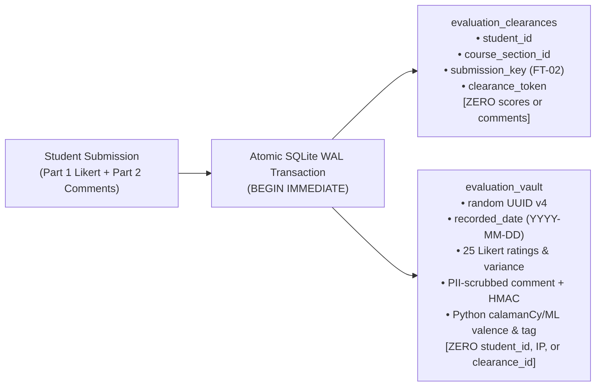
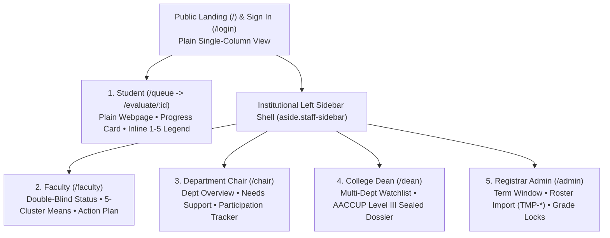

# School AAAAA13 — EvaluaTech Institutional System Architecture & Operational Manual

**Platform:** EvaluaTech
**Governance Standard:** AACCUP Level III (Area III: Curriculum and Instruction) & CHED CMO 46 Institutional Quality Assurance
**Legal Framework:** Republic Act No. 10173 (Data Privacy Act of 2012)
**Systems & Web Layer:** Safe Rust (`#![forbid(unsafe_code)]`: `evaluatech-server` Axum + SQLite WAL, `evaluatech-web` WebAssembly SPA, `evaluatech-nlp` non-ML descriptive primitives)
**Language Intelligence & ML Layer:** Python 3.12 (`nlp-python/`: `tl_calamancy_md-0.2.0` + `en_core_web_md` + `vaderSentiment` + `scikit-learn` Calibrated Ensemble)
**Document Revision:** 5.0.0

---

## 1. Executive Summary & Institutional Mission

**EvaluaTech** is the institutional Student Evaluation of Teachers (SET) and multilingual qualitative analytics platform for **School AAAAA13**. It replaces coercive, error-prone evaluation workflows with a privacy-preserving polyglot architecture that separates systems security (Safe Rust) from Filipino/English linguistic machine learning (Python `calamanCy` + `scikit-learn`).

### Strategic Design Principles
1. **Zero Permits Policy & Zero Receipt Friction**: Examination permits are never gated behind evaluations, and manual receipt-verification forms have been eliminated. Completion is tracked internally per enrolled subject on the post-login Student Profile Dashboard (`/queue`).
2. **Role-Tailored Navigation**:
   - **Students (`/queue`, `/evaluate/:id`) & Public Visitors (`/`, `/login`)**: Plain, distraction-free single-column webpage with zero sidebars and zero global scale modals.
   - **Professors, Department Chairs, College Deans & Registrar Officers (`/faculty`, `/chair`, `/dean`, `/admin`)**: Persistent **Institutional Left Sidebar (`aside.staff-sidebar`)** with live badge counters and scoped cross-portal navigation.
3. **Strict ML Scientific Integrity**: Multilingual models are trained strictly on development and disjoint naturalistic training corpora (`nlp-python/data/expanded_training_corpus.csv`), validated via 5-Fold Stratified Cross-Validation, and evaluated blindly on the untouched holdout partition (`docs/analysis/test_partition.csv`) with zero result alteration.

---

## 2. Core Cryptographic & Governance Invariants

### 2.1 Dual-Token Cryptographic Decoupling (`RA 10173`)

Neither table holds a foreign key, shared hash, or sub-second timestamp linking to the other, making student-to-response correlation impossible for any actor, including System Administrators.

### 2.2 Population Variance Guard ($\sigma^2 = 0$) & Immediate Readiness ($0\text{s+}$)
- **Zero Artificial Dwell Gates**: Students submit as soon as they finish (`dwell_time_seconds >= 0`).
- **Straight-Lining Check**: Population variance $\sigma^2 = \frac{1}{N}\sum_{i=1}^N (x_i - \mu)^2$ is computed in `evaluatech-nlp`. If $\sigma^2 = 0$ and `confirm_uniform = false`, the student receives one polite confirmation prompt (`ZERO_VARIANCE_CONFIRMATION_REQUIRED`); confirming records `is_straight_lined = 1`.

### 2.3 Double-Blind Faculty Release Gate
`evaluatech-server` returns `HTTP 403 DOUBLE_BLIND_LOCKED` on faculty section analytics until **both** `term_grades_submitted = 1` and `registrar_lock = 1` hold for that section.

---

## 3. Role-Tailored Operational Workflows

1. **Student (`/queue`, `/evaluate/:id`)**: Lands immediately on their **User Profile Dashboard** showing overall completion (`e.g., 4 / 6 Completed`) and pending subjects with direct **Evaluate** actions. Part 1 renders the 25 Likert items with an inline `1–5` rating legend; Part 2 captures structured qualitative reflections.
2. **Faculty / Professor (`/faculty`)**: Navigates via the left sidebar between section summaries, 5-cluster rating distributions, anonymized comment insights, and collaborative pedagogical action plans once grades are locked.
3. **Department Chair (`/chair`)**: Strictly scoped to `department_id` (`403` on cross-department queries). Monitors departmental completion velocity, reviews instructors on the support watchlist ($\mu < 3.50$ or $\text{Negative} > 35\%$), and endorses coaching plans.
4. **College Dean (`/dean`)**: Scoped across all departments in their college. Audits multi-department trends, support interventions, and compiles SHA-256 sealed **AACCUP Level III Area III Dossiers** (`AAAAA13-AACCUP3-*`).
5. **University Registrar & System Administrator (`/admin`)**: Manages `Asia/Manila` evaluation windows, atomic CSV/JSON roster imports issuing one-time passwords (`TMP-*`, `must_change_password = 1`), bulk Registrar grade locks, and non-coercive participation follow-ups.

---

## 4. Python Multilingual NLP & Machine Learning Pipeline (`nlp-python/`)

`evaluatech-server` communicates over a persistent UTF-8 JSON-RPC stdio pipe (`evaluatech-server/src/python_nlp.rs`) with `evaluatech_nlp_py.worker`:

1. **Defense-in-Depth Sanitization**: Redacts emails (`[REDACTED-EMAIL]`), Philippine mobile numbers (`[REDACTED-PHONE]`), student IDs (`[REDACTED-ID]`), control characters, and prompt-injection delimiters.
2. **Pretrained Bilingual Linguistic Analysis (`calamancy_pipeline.py`)**:
   - **Tagalog / Taglish**: `tl_calamancy_md-0.2.0` (`tok2vec`, `trainable_lemmatizer`, `tagger`, `morphologizer`, and **200-dimensional TLUnified static word vectors**).
   - **English**: `en_core_web_md` (**300-dimensional English static word vectors**).
   - **Negation-Aware Semantic Pooling**: Pools content-weighted `500d` L2-normalized static word vectors with polarity inversion across standard (`not`, `hindi`, `walang`, `without`) and comparative (`rather than`, `instead of`, `imbes na`) negation scopes.
3. **Neuro-Symbolic VADER + Discourse Features (`sentiment_ml.py`)**:
   - Computes multilingual VADER compound polarity in $[-1.0, +1.0]$, Clause-1 vs. Clause-2 contrastive balance (`pero`, `kaso`, `however`, `though`), normative adequacy cues (`naman`, `karaniwan`, `naaayon`, `typical`, `aligned with`), and remedial positive practice overrides (`common mistakes`, `reduce exam stress`).
4. **Calibrated `scikit-learn` Ensemble & Facility Isolation**:
   - Predicts calibrated probabilities across `Positive`, `Neutral`, and `Negative`, plus the 5 institutional Likert clusters (`Pedagogical Delivery`, `Assessment & Grading`, `Classroom Management`, `Professional Conduct`, `Student Support & Mentorship`) while isolating campus facility/extracurricular remarks under `Unclassified / Needs Review`.

---

## 5. Multi-Tier Verification Matrix

| Tier | Command / Suite | Verification Scope |
| :---: | :--- | :--- |
| **Tier 1** | `pytest nlp-python/tests -v` | Python `tl_calamancy_md-0.2.0` + `en_core_web_md` loading, PII redaction, facility isolation, zero test-leakage hash audit, and exact metadata benchmark parity. |
| **Tier 2** | `cargo clippy --workspace --all-targets --all-features -- -D warnings` | Zero-unsafe (`#![forbid(unsafe_code)]`) static analysis across `evaluatech-nlp`, `evaluatech-web`, and `evaluatech-server`. |
| **Tier 3** | `cargo test --workspace --all-features` | End-to-end Rust + warm Python NLP worker tests covering RBAC, Dual-Token decoupling, `FT-02` idempotency, Double-Blind locks, and 63 OWASP security controls. |
| **Tier 4** | Headless Chromium DOM & Responsive Audit | Verifies plain student layout (`aside.staff-sidebar == 0`), staff left-sidebar presence (`aside.staff-sidebar == 1`), zero global `Scale` controls, WCAG 2.2 AAA contrast, and `>= 44×44px` tap targets. |
