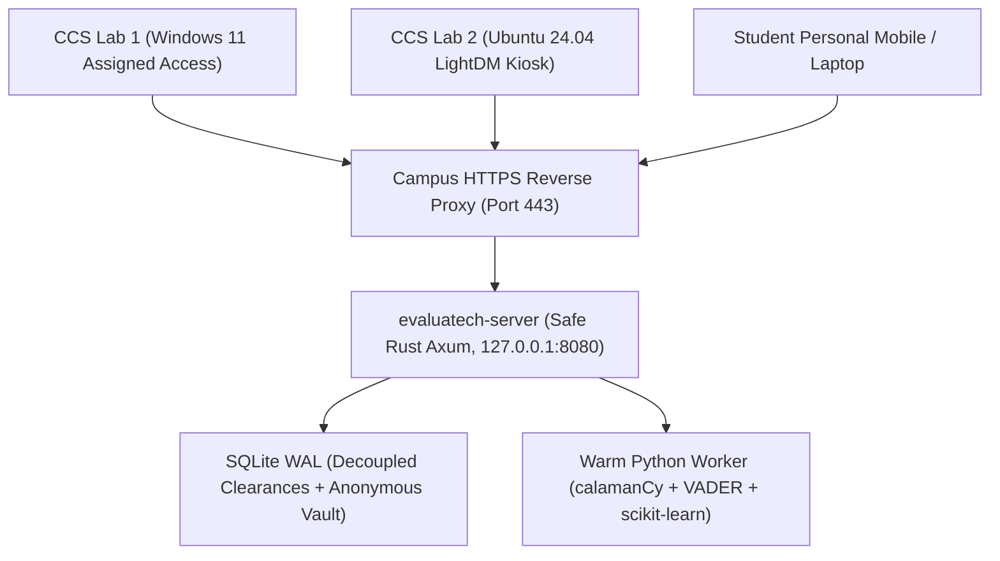

# School AAAAA13 — EvaluaTech
# Managed Kiosk Deployment Plan for Campus Computer Laboratories

**Document Version:** 2.0 (AY 2026–2027)
**Classification:** Institutional IT Infrastructure & Laboratory Administration
**Target Environments:** University Computer Laboratories, Supervised Evaluation Terminals, and Registrar Stations

---

## 1. Executive Summary: Personal Browser Mode vs. Managed Laboratory Kiosk Mode

A strict architectural boundary separates **Personal Device Browser Access** from **OS-Managed Campus Laboratory Kiosks**:

| Dimension | Personal Devices (Smartphones, Laptops) | Managed Campus Lab Kiosks (CCS / Engineering Labs) |
| :--- | :--- | :--- |
| **Enforcement Layer** | Standard WebAssembly SPA (`evaluatech-web`) | Operating System Kiosk Policy (Windows Assigned Access / LightDM) |
| **Navigation Layout** | Plain single-column Student Dashboard (`/queue`) | Identical plain Student Dashboard inside full-screen browser shell |
| **Exit Mechanism** | User closes tab or signs out anytime | OS keyboard filter; lab proctor credentials required to exit OS session |
| **Session Persistence** | Ephemeral `sessionStorage` cleared on tab close | Ephemeral `sessionStorage` + `--incognito` profile wiped on sign-out |

### Non-Negotiable Institutional Guardrails
1. **Zero Intrusive Lockdown on Personal Devices**: Students evaluating on personal phones or laptops never face artificial fullscreen traps, focus-loss penalties, or unclosable popups.
2. **Truthful Security Claims**: Browser JavaScript/WASM cannot block OS-level shortcuts (`Alt+Tab`, `Win`, `Ctrl+Alt+Del`); physical shortcut blocking is performed exclusively by Windows Assigned Access or Linux LightDM in supervised campus labs.
3. **Zero Penalization on Focus Changes**: Transient focus changes never invalidate drafts or auto-submit incomplete forms.

---

## 2. Campus Laboratory Kiosk Configuration

### A. Windows 11 Enterprise (Assigned Access with Microsoft Edge)

#### Step 1: Provision Non-Privileged Local Kiosk Account
```powershell
net user AAAAA13StudentKiosk EvaluatechLab2026! /add /passwordchg:no
wmic useraccount where name='AAAAA13StudentKiosk' set PasswordExpires=FALSE
```

#### Step 2: Point Assigned Access to EvaluaTech
In Windows Settings (`Accounts -> Other users -> Set up a kiosk`), bind `AAAAA13StudentKiosk` to **Microsoft Edge**:
- **Kiosk Mode Type:** Public Browsing / Interactive Full-Screen (`InPrivate` enabled).
- **Target URL:** `https://evaluatech.aaaaa13.edu/login` (or `http://127.0.0.1:8080/login` on isolated lab VLAN pilot hosts).
- **Idle Timeout:** 10 minutes (wipes `InPrivate` session and returns cleanly to `/login`).

#### Step 3: Windows Keyboard Filter Policy
Enable **Keyboard Filter** under `Computer Configuration -> Administrative Templates -> System -> Keyboard Filter` to block `Win`, `Alt+Tab`, `Alt+F4`, and `Ctrl+Shift+Esc` for `AAAAA13StudentKiosk` while preserving `Ctrl+Alt+Delete` for laboratory proctors.

---

### B. Ubuntu 24.04 LTS Campus Laboratories (LightDM + Chromium)

Create `/usr/local/bin/evaluatech-kiosk.sh` (`chmod +x`):
```bash
#!/usr/bin/env bash
xset s off
xset -dpms
xset s noblank

chromium-browser \
  --kiosk \
  --incognito \
  --noerrdialogs \
  --disable-infobars \
  --no-first-run \
  --disable-translate \
  --disable-save-password-bubble \
  --disable-session-crashed-bubble \
  "https://evaluatech.aaaaa13.edu/login"
```

Configure `/etc/lightdm/lightdm.conf.d/99-evaluatech-kiosk.conf`:
```ini
[Seat:*]
autologin-user=aaaaa13kiosk
autologin-session=evaluatech-kiosk
```

---

## 3. Proctor Recovery & Window Lifecycle Procedures

1. **Interrupted Workstation Recovery**: Draft Likert selections and written responses stay in local `sessionStorage` until submission. If a terminal reboots before Step 2 submission, no `evaluation_clearances` or `evaluation_vault` rows were committed, so the student simply signs back in at `/login` and completes the pending subject on `/queue`.
2. **Idempotent Network Retries (`FT-02`)**: If campus Wi-Fi or a lab switch drops a response packet after the student clicks **Submit Evaluation**, retrying with the same `submission_key` returns the original completion status without inserting duplicate vault records.
3. **Evaluation Window Closure**: When `ends_at` (`Asia/Manila`) passes or the Registrar closes the window in `/admin`, `evaluatech-server` rejects late writes cleanly while preserving all previously committed anonymous vault records.

---

## 4. Network & Service Topology



---

## 5. Compliance Summary

- **RA 10173 (Data Privacy Act of 2012)**: Ephemeral `sessionStorage` tokens + `--incognito`/`InPrivate` kiosk resets prevent credential or draft carryover across consecutive lab users.
- **WCAG 2.2 AAA Accessibility**: `>= 7.0:1` contrast, `A+ Large Text` & `Dark View` in the Settings gear menu, `>= 44×44px` tap targets, and keyboard `1`–`5` rating shortcuts operate identically in laboratory kiosk sessions and personal browsers.
