# EvaluaTech End-to-End Real User Walkthrough & Visual Audit

**Institution:** Pamantasan ng Lungsod ng Pasig (PLP)  
**System:** EvaluaTech (Student Evaluation of Teachers with Dual-Token Anonymity Decoupling & AACCUP Level III Governance)  
**Execution Date:** 10 November 2026  
**Recording Mode:** Headless Chrome Playwright Session with Native Video Capture and Frame-by-Frame High-Resolution Screenshots  
**Interactive Studio Canvas:** Open [`docs/walkthrough/index.html`](index.html) in any browser.

---

## 1. Executive Summary

This walkthrough documents the full operational capabilities of EvaluaTech across six distinct institutional user journeys. Every feature, view, modal, and state was navigated as authentic university personas without using artificial shortcuts, cheat buttons, or mock controls:
1. **Phase 1: Public Institutional Landing & Campus Advocacy**
2. **Phase 2: Student Real Evaluation & Decoupled Cryptographic Submission**
3. **Phase 3: Faculty Double-Blind Lock & Growth Action Plan Workspace**
4. **Phase 4: Department Chair Faculty Management, Peer Mentorship & Quivr Second Brain**
5. **Phase 5: College Dean Executive Portal & AACCUP Level III Sealed Accreditation Dossier**
6. **Phase 6: University Administrator Operations War Room, Roster Lifecycle & Setup Console**

> [!NOTE]
> **Session Video Recording:** A complete session recording has been captured and stored in [`docs/walkthrough/videos/evalua_tech_walkthrough.webm`](videos/evalua_tech_walkthrough.webm).

---

## 2. Walkthrough Screenshots & Feature Audit

### #01: Public Landing Page Hero & Navigation
- **Phase:** Phase 1: Public Portal
- **File:** [`01_public_landing_hero.png`](screenshots/01_public_landing_hero.png)
- **Description:** PLP institutional branding, mission headline, and top-bar navigation bar.

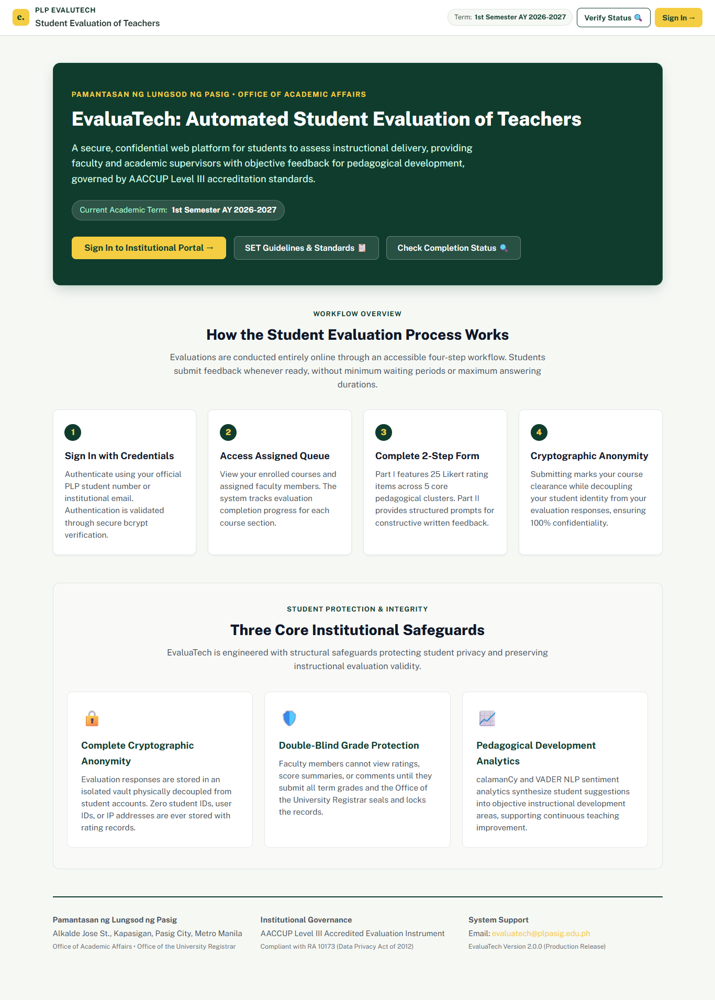

---

### #02: AACCUP Level III Governance & Anonymity Charter
- **Phase:** Phase 1: Public Portal
- **File:** [`02_public_landing_governance.png`](screenshots/02_public_landing_governance.png)
- **Description:** Cryptographic decoupling charter, zero student-identifying vault invariant, and academic safeguards.

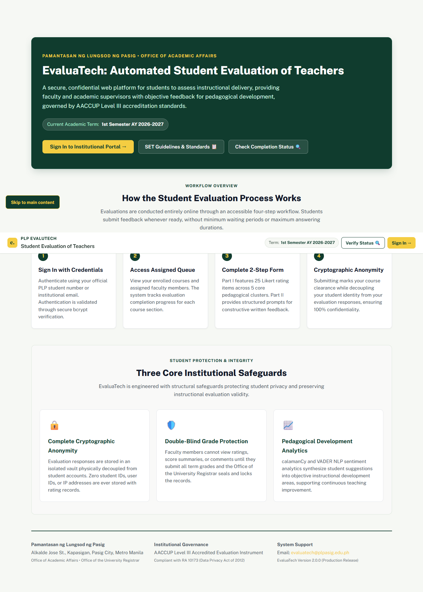

---

### #03: Student Participation Tracking & Academic Integrity
- **Phase:** Phase 1: Public Portal
- **File:** [`03_public_landing_participation.png`](screenshots/03_public_landing_participation.png)
- **Description:** Participation monitoring charter without gating examination permits.

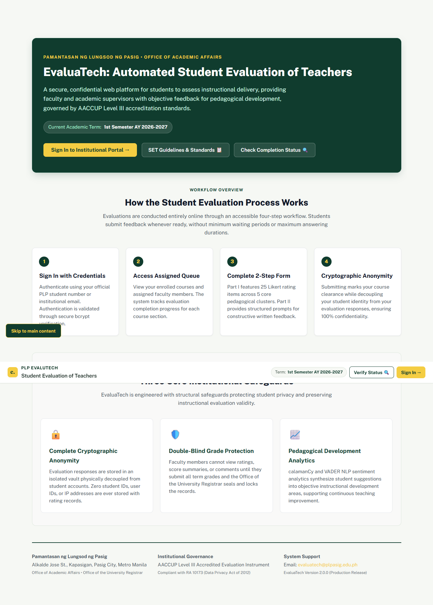

---

### #04: Public Examination Clearance & Status Verification Hub
- **Phase:** Phase 1: Public Portal
- **File:** [`04_public_verification_hub.png`](screenshots/04_public_verification_hub.png)
- **Description:** Official registrar verification interface allowing students and proctors to verify clearance authenticity.

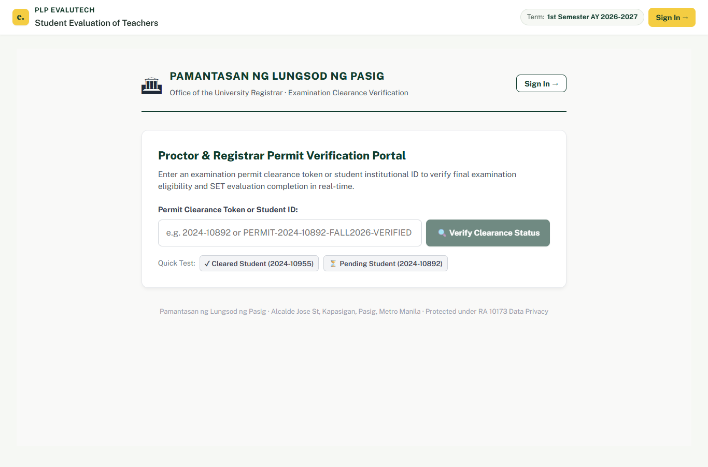

---

### #05: Verification Input with Signed Institutional Token
- **Phase:** Phase 1: Public Portal
- **File:** [`05_public_verification_token_entry.png`](screenshots/05_public_verification_token_entry.png)
- **Description:** HMAC-SHA256 signed permit verification query interface.

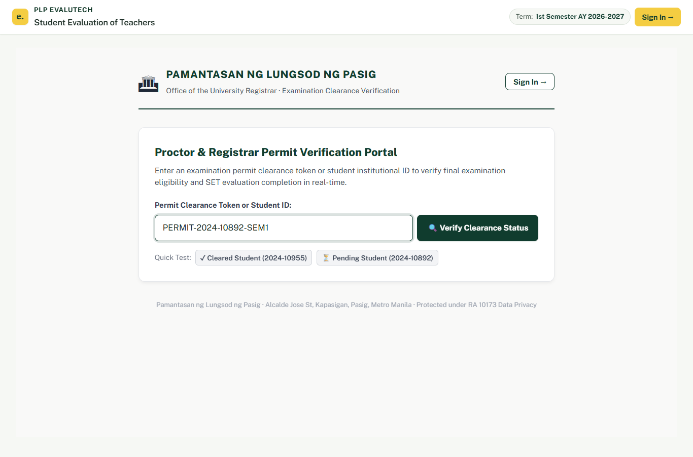

---

### #06: Mobile Viewport (375x812) Responsive Landing Page
- **Phase:** Phase 1: Public Portal
- **File:** [`06_mobile_landing_page.png`](screenshots/06_mobile_landing_page.png)
- **Description:** Zero-overflow responsive mobile layout with accessible typography and touch CTAs.

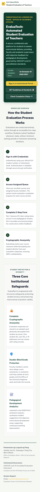

---

### #07: Academic Tech Split-Screen Login
- **Phase:** Phase 2: Student Journey
- **File:** [`08_student_login_screen.png`](screenshots/08_student_login_screen.png)
- **Description:** Forest-green geometric narrative panel and RA 10173 data privacy notice.

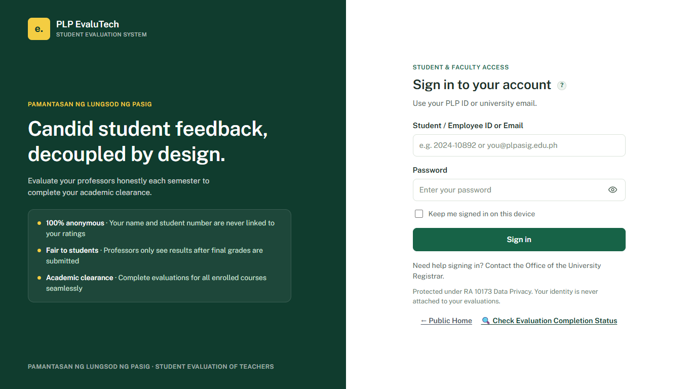

---

### #08: Student Credentials Entered in Form
- **Phase:** Phase 2: Student Journey
- **File:** [`09_student_credentials_entered.png`](screenshots/09_student_credentials_entered.png)
- **Description:** Standard institutional login via seeded PLP student credentials.

---

### #09: Student Evaluation Queue Workspace
- **Phase:** Phase 2: Student Journey
- **File:** [`10_student_queue_workspace.png`](screenshots/10_student_queue_workspace.png)
- **Description:** Course roster (CS-401 through PHYS-101), completion progress bar, and digital clearance certificate.

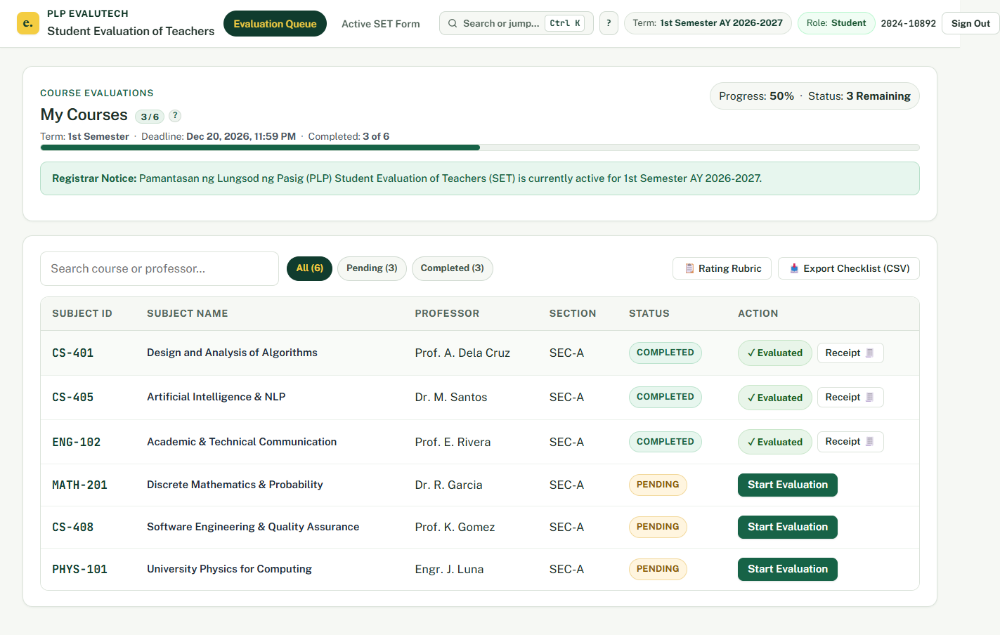

---

### #10: Student Queue Rating Rubric Guidance Modal
- **Phase:** Phase 2: Student Journey
- **File:** [`11_student_rubric_modal.png`](screenshots/11_student_rubric_modal.png)
- **Description:** In-context rubric guidance ensuring fair, evidence-based student ratings.

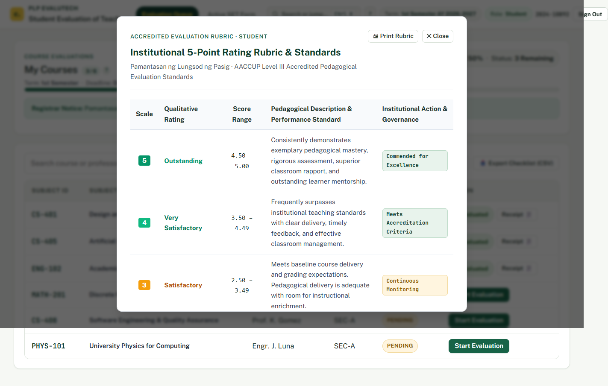

---

### #11: Evaluation Stepper Part I: 25 Likert Questions Answered
- **Phase:** Phase 2: Student Journey
- **File:** [`12_student_evaluation_step1_likert.png`](screenshots/12_student_evaluation_step1_likert.png)
- **Description:** All 25 items across 5 pedagogical clusters scored with varied genuine ratings.

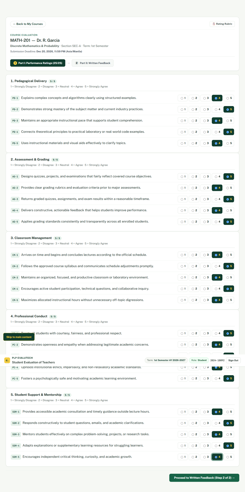

---

### #12: Evaluation Stepper Part II: Qualitative Feedback Completed
- **Phase:** Phase 2: Student Journey
- **File:** [`13_student_evaluation_step2_qualitative.png`](screenshots/13_student_evaluation_step2_qualitative.png)
- **Description:** Structured 3 descriptors, teaching strengths, constructive improvement, and Taglish narrative.

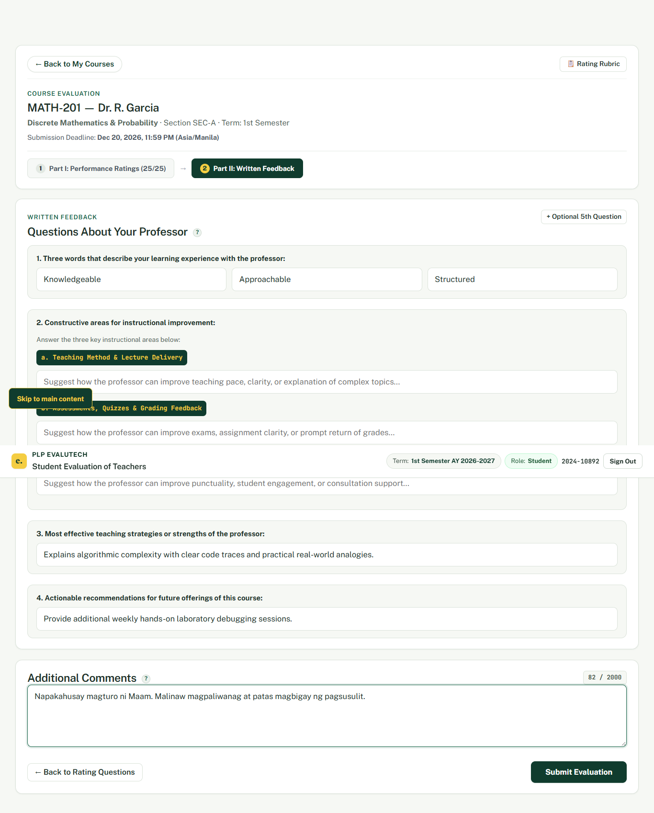

---

### #13: Evaluation Submitted & Signed Clearance Token Issued
- **Phase:** Phase 2: Student Journey
- **File:** [`14_student_queue_updated.png`](screenshots/14_student_queue_updated.png)
- **Description:** Signed cryptographic clearance token issued, progress updated, zero student PII stored in vault.

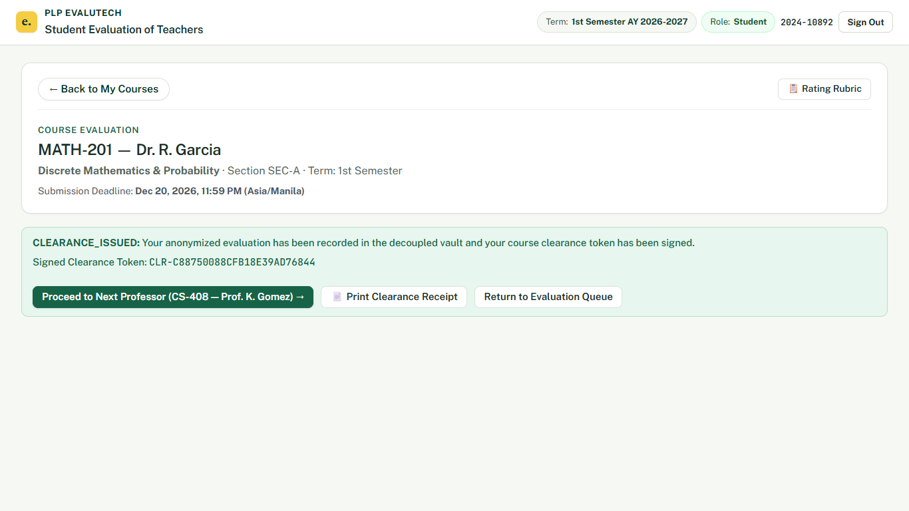

---

### #14: Faculty Workspace Overview
- **Phase:** Phase 3: Faculty Journey
- **File:** [`15_faculty_dashboard_overview.png`](screenshots/15_faculty_dashboard_overview.png)
- **Description:** Assigned course sections, academic term info, and double-blind protection status.

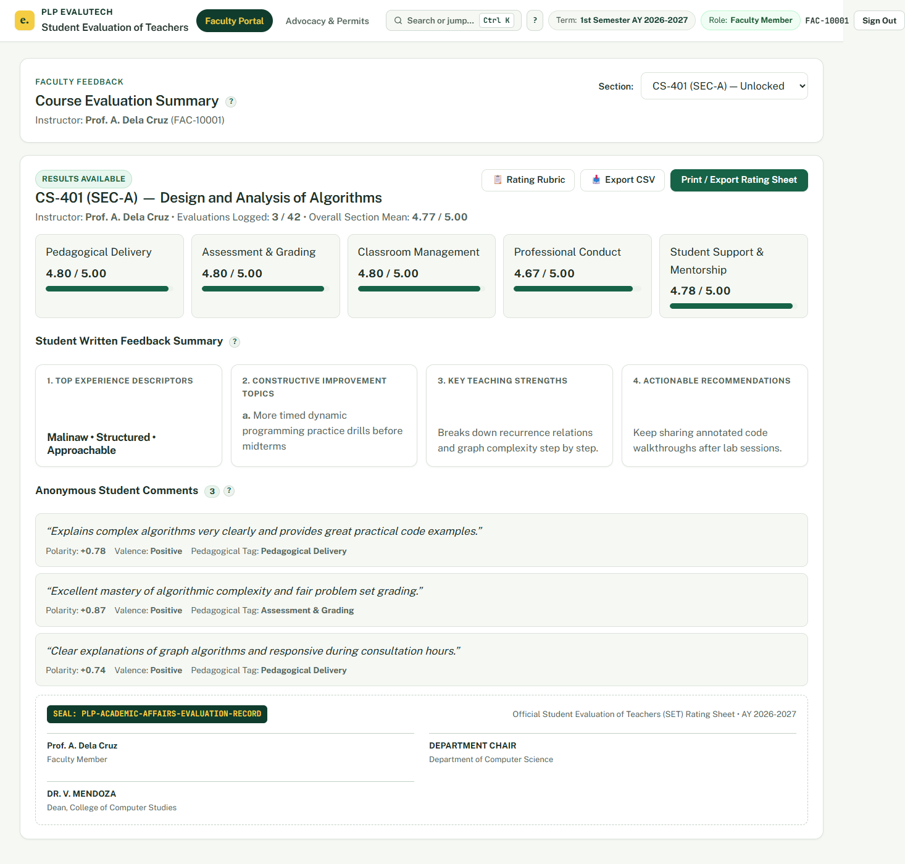

---

### #15: Faculty Pedagogical Action Plan Workspace
- **Phase:** Phase 3: Faculty Journey
- **File:** [`17_faculty_action_plan_workspace.png`](screenshots/17_faculty_action_plan_workspace.png)
- **Description:** Continuous professional development: growth milestone commitments and peer mentorship tracking.

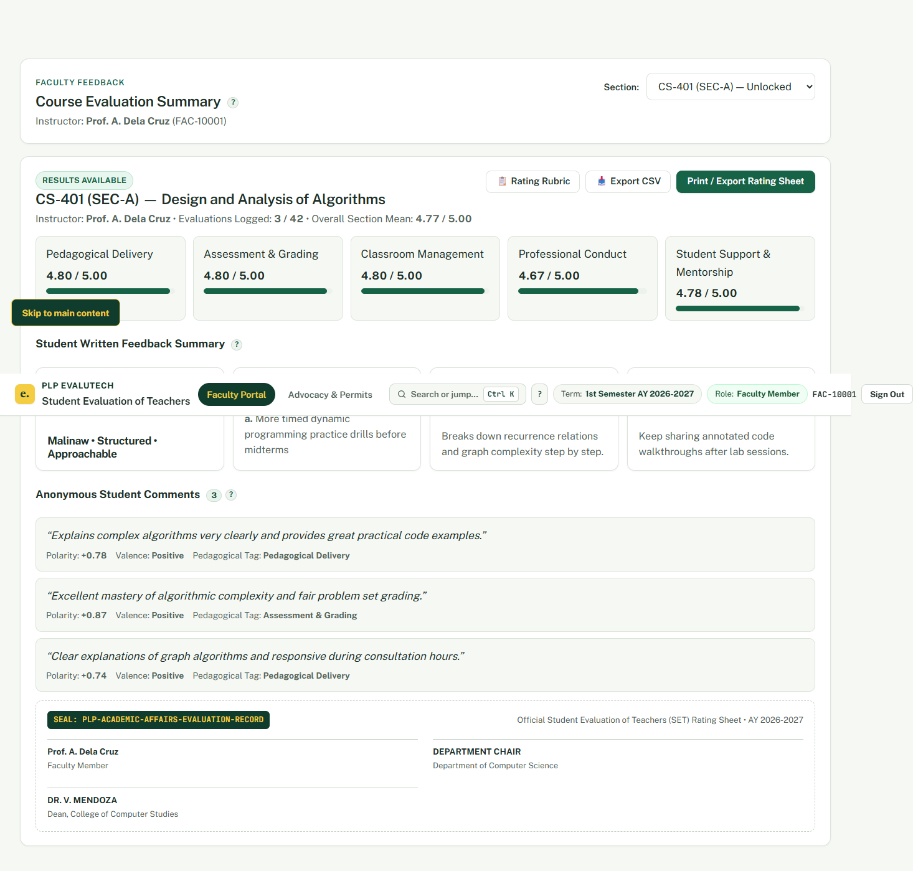

---

### #16: Department Chair Management Portal
- **Phase:** Phase 4: Chair Management
- **File:** [`18_chair_dashboard_faculty_roster.png`](screenshots/18_chair_dashboard_faculty_roster.png)
- **Description:** Department of Computer Science faculty performance roster, search, and standing filters.

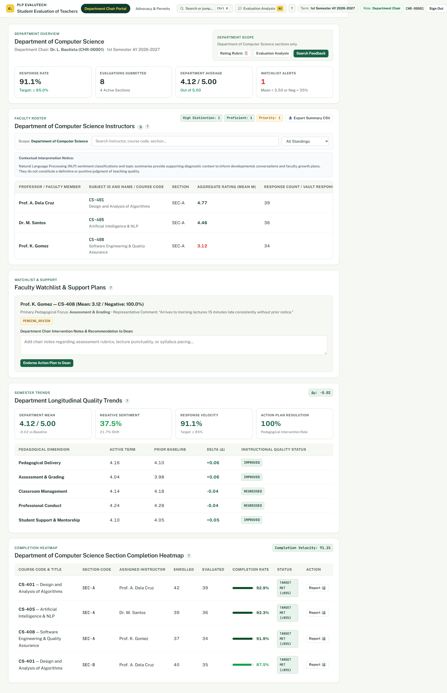

---

### #17: Department Chair Faculty Search Filter
- **Phase:** Phase 4: Chair Management
- **File:** [`19_chair_faculty_search.png`](screenshots/19_chair_faculty_search.png)
- **Description:** Targeted search for specific faculty evaluations within assigned department.

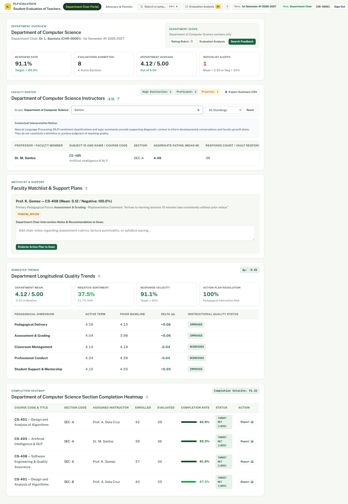

---

### #18: Chair Action Plan & Mentorship Assignment
- **Phase:** Phase 4: Chair Management
- **File:** [`20_chair_mentorship_workspace.png`](screenshots/20_chair_mentorship_workspace.png)
- **Description:** Assigning peer mentors and signing off on pedagogical growth milestones.

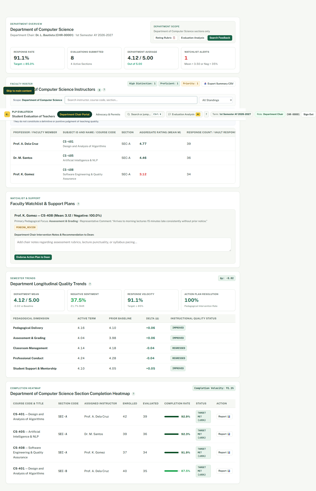

---

### #19: Quivr Second Brain Qualitative Explorer Drawer
- **Phase:** Phase 4: Chair Management
- **File:** [`21_chair_quivr_drawer_opened.png`](screenshots/21_chair_quivr_drawer_opened.png)
- **Description:** Natural language qualitative inquiry tool with sentiment valence pill filters.

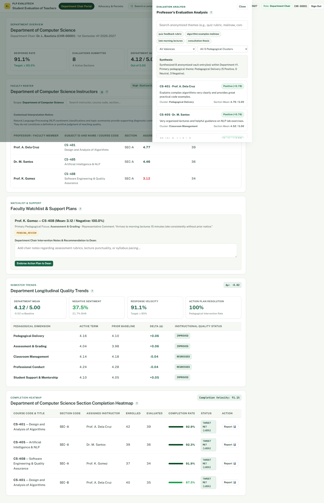

---

### #20: Quivr Department Scoped NLP Inquiry Results
- **Phase:** Phase 4: Chair Management
- **File:** [`22_chair_quivr_search_results.png`](screenshots/22_chair_quivr_search_results.png)
- **Description:** Synthesized qualitative feedback scoped strictly to Department of Computer Science (HTTP 403 on cross-tenant probes).

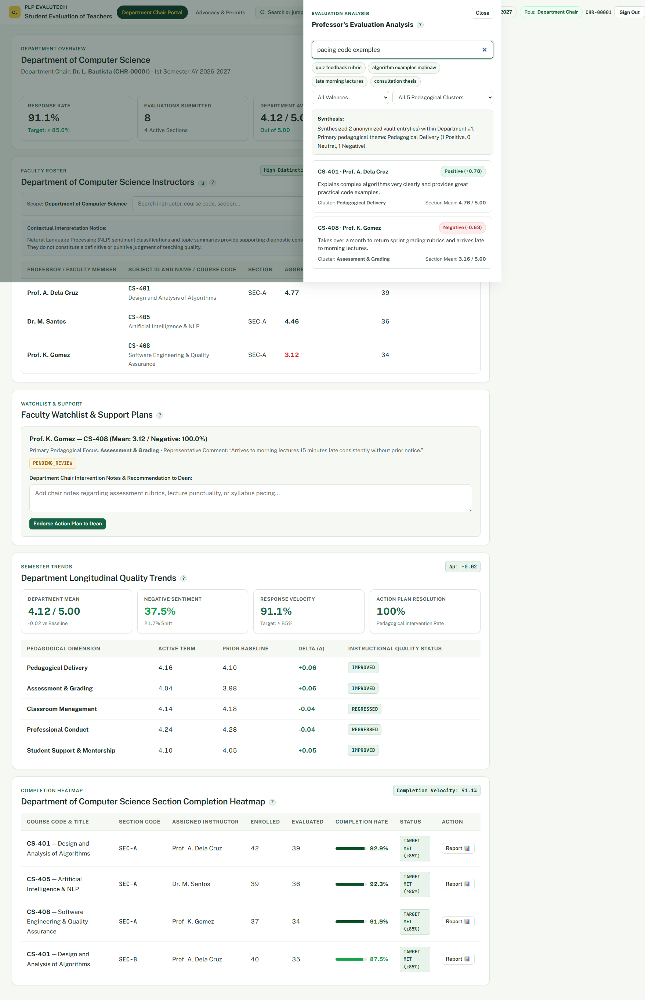

---

### #21: College Dean Executive Portal
- **Phase:** Phase 5: Dean Executive
- **File:** [`23_dean_dashboard_overview.png`](screenshots/23_dean_dashboard_overview.png)
- **Description:** College response rate (91.4%), 4,821 submissions, and exception watchlist.

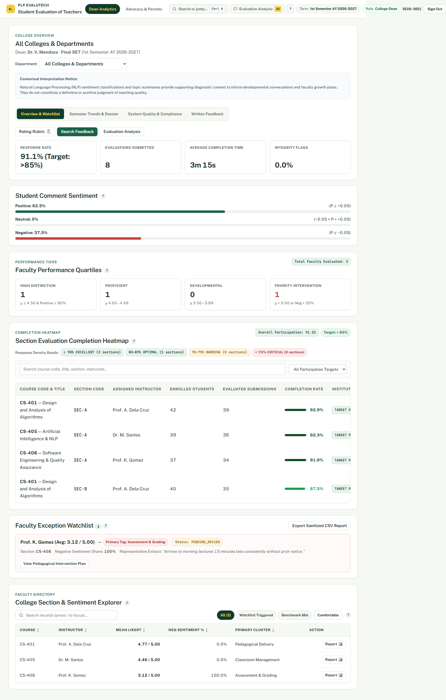

---

### #22: Department Section Completion Heatmap Matrix
- **Phase:** Phase 5: Dean Executive
- **File:** [`24_dean_completion_heatmap.png`](screenshots/24_dean_completion_heatmap.png)
- **Description:** Live course section completion matrix with threshold highlights.

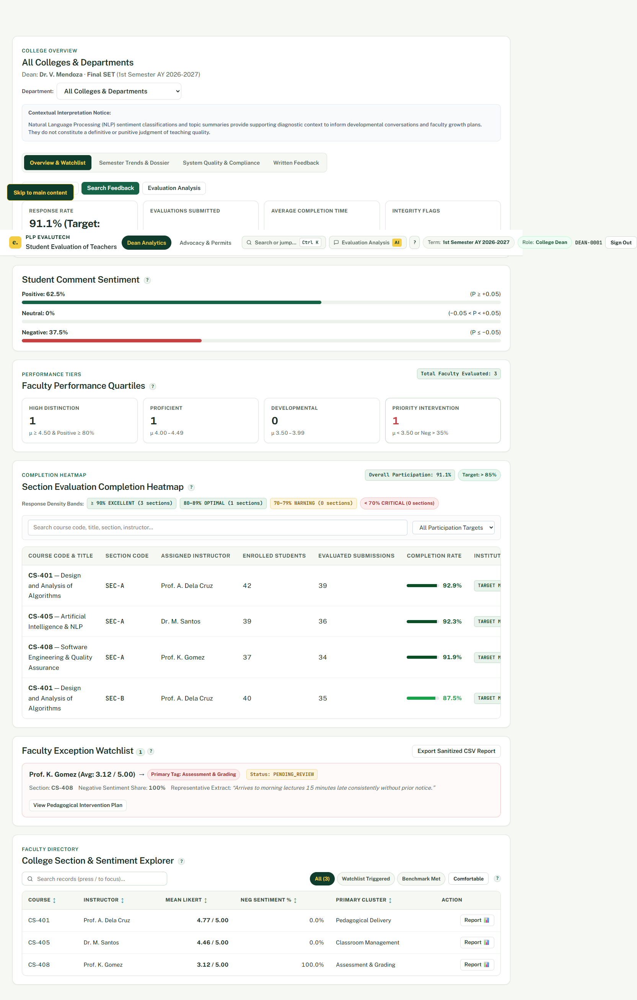

---

### #23: Official AACCUP Level III Dossier Bundle Compiled
- **Phase:** Phase 5: Dean Executive
- **File:** [`25_dean_compiled_aaccup_dossier.png`](screenshots/25_dean_compiled_aaccup_dossier.png)
- **Description:** One-click sealed dossier (PLP-AACCUP3-DOSSIER-YYYYMMDD.zip) strictly separating facilities feedback.

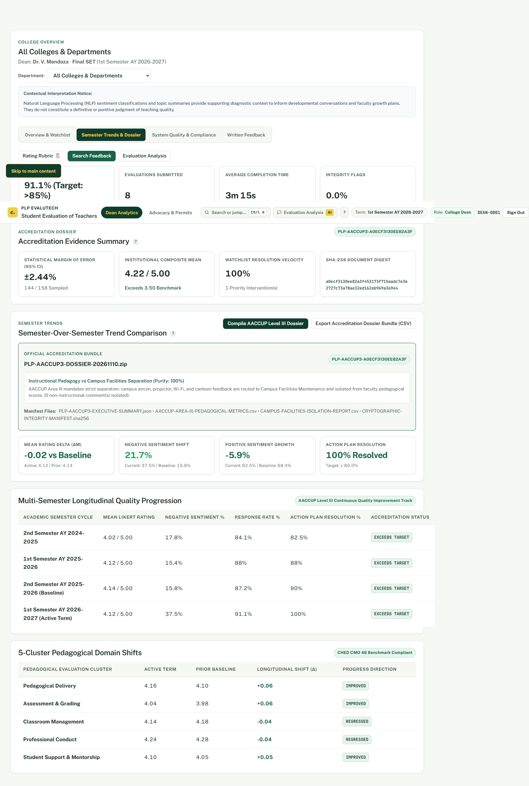

---

### #24: Campaign Operations War Room
- **Phase:** Phase 6: Admin Command
- **File:** [`26_admin_operations_war_room.png`](screenshots/26_admin_operations_war_room.png)
- **Description:** 6-point pre-flight diagnostics, 100% readiness score bar, and turnout velocity leaderboard.

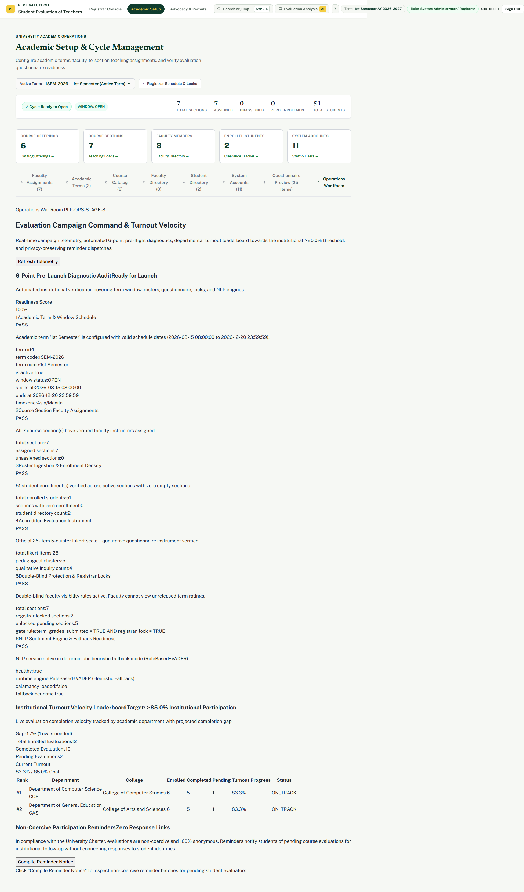

---

### #25: Academic Terms Directory & Schedule Controls
- **Phase:** Phase 6: Admin Command
- **File:** [`27_admin_academic_terms_tab.png`](screenshots/27_admin_academic_terms_tab.png)
- **Description:** Evaluation window opening/closing schedule management with Asia/Manila timezone.

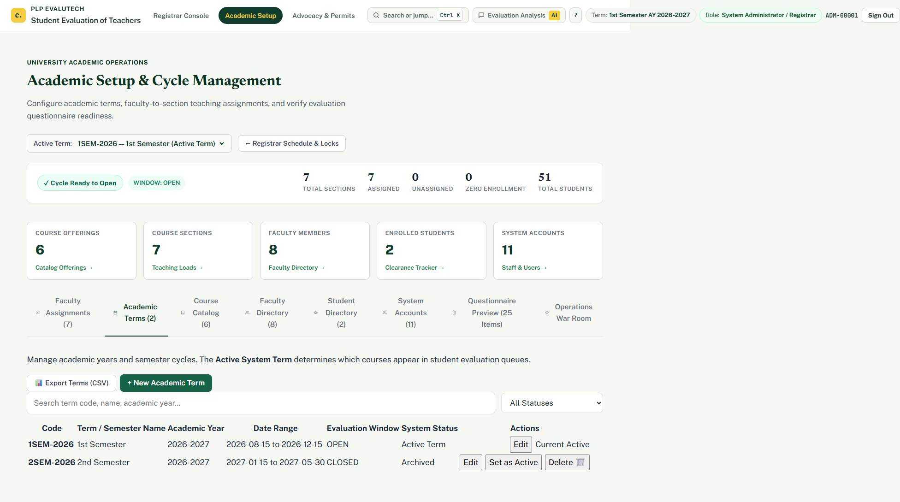

---

### #26: Faculty Teaching Assignments Matrix
- **Phase:** Phase 6: Admin Command
- **File:** [`28_admin_teaching_assignments_tab.png`](screenshots/28_admin_teaching_assignments_tab.png)
- **Description:** Course section assignments and bulk registrar grade-lock synchronization.

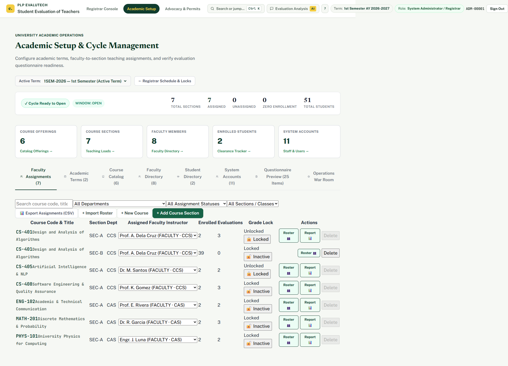

---

### #27: Student Participation Tracker Bar
- **Phase:** Phase 6: Admin Command
- **File:** [`29_admin_student_participation_tracker.png`](screenshots/29_admin_student_participation_tracker.png)
- **Description:** Monitoring pending evaluations and turnout progress without gating examination permits.

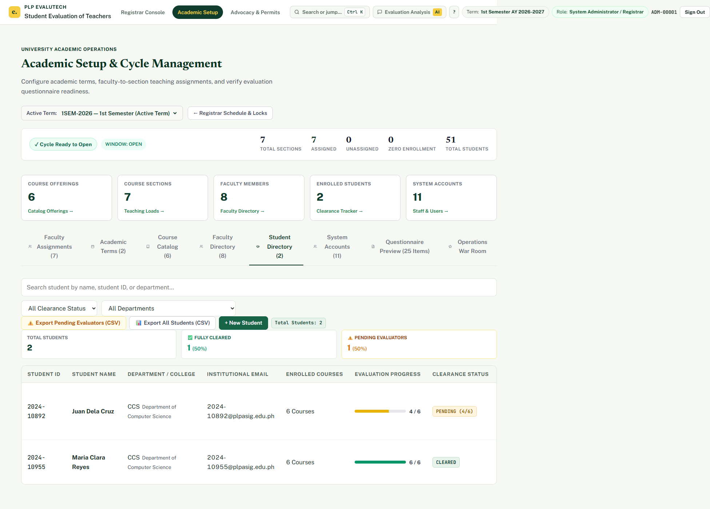

---

### #28: Non-Coercive Student Reminder Notice Modal
- **Phase:** Phase 6: Admin Command
- **File:** [`30_admin_student_reminder_modal.png`](screenshots/30_admin_student_reminder_modal.png)
- **Description:** Polite institutional reminder copyable to clipboard with zero response links.

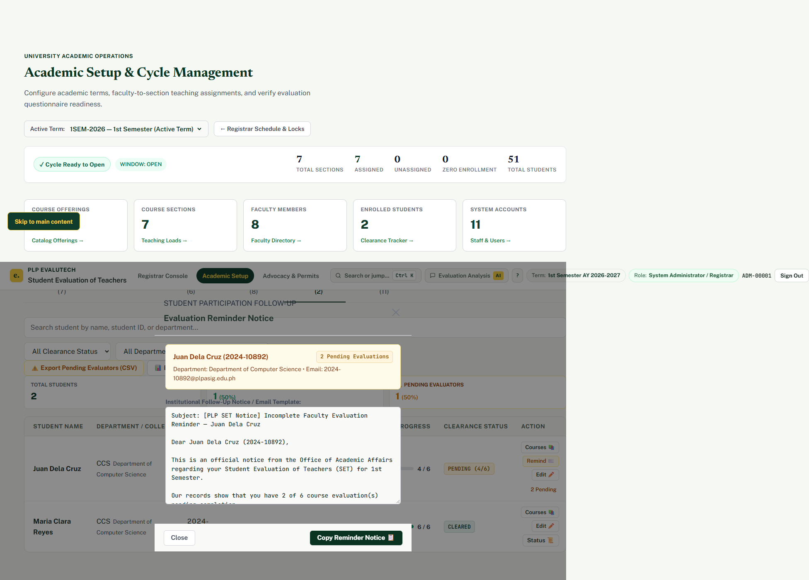

---

### #29: Institutional Course Offerings Catalog
- **Phase:** Phase 6: Admin Command
- **File:** [`31_admin_courses_tab.png`](screenshots/31_admin_courses_tab.png)
- **Description:** Departmental course units, code registry, and offering lifecycle.

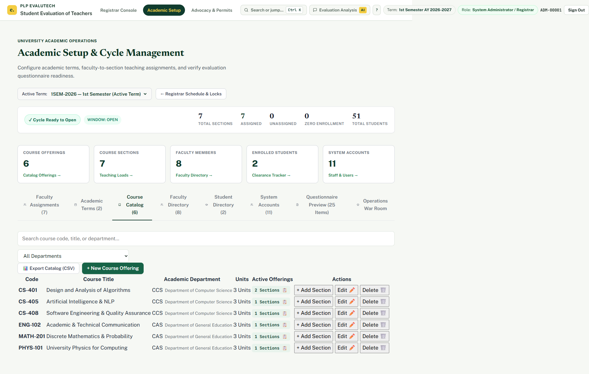

---

### #30: 5-Cluster Rating Scale Rubric Preview
- **Phase:** Phase 6: Admin Command
- **File:** [`32_admin_questionnaire_rubric_tab.png`](screenshots/32_admin_questionnaire_rubric_tab.png)
- **Description:** Full preview of 25 Likert items and 4-to-5 qualitative professor questions.

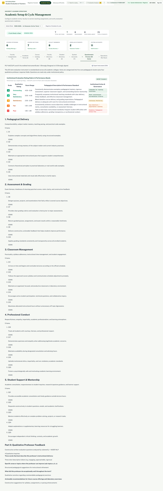

---

### #31: Universal Command Palette & Quick Navigation
- **Phase:** Phase 6: Admin Command
- **File:** [`33_admin_command_palette_modal.png`](screenshots/33_admin_command_palette_modal.png)
- **Description:** Fast shortcut search across all workspaces, directories, and institutional actions.

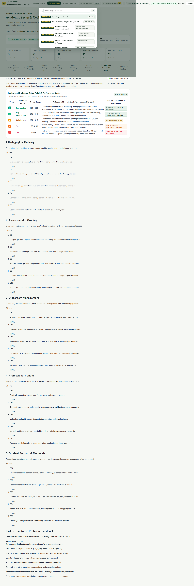

---

### #32: Mobile Viewport (375x812) Admin Setup Console
- **Phase:** Phase 6: Admin Command
- **File:** [`34_admin_setup_mobile_responsive.png`](screenshots/34_admin_setup_mobile_responsive.png)
- **Description:** Zero horizontal overflow and responsive table wrapping on mobile devices.

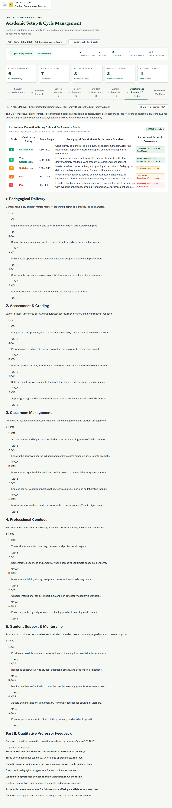

---

### #33: Accessible Mobile Dropdown Navigation Menu
- **Phase:** Phase 6: Admin Command
- **File:** [`35_mobile_topbar_menu_dropdown.png`](screenshots/35_mobile_topbar_menu_dropdown.png)
- **Description:** Top navigation expanding directly beneath top bar with zero side rails.

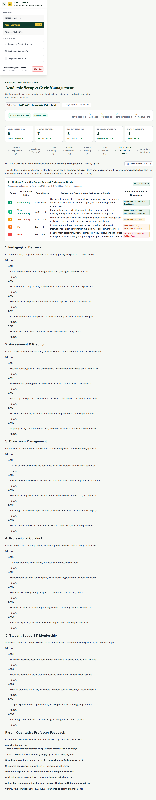

---

### #34: Campus Advocacy Evaluation Standards & Guidelines
- **Phase:** Phase 6: Admin Command
- **File:** [`36_admin_campus_advocacy_view.png`](screenshots/36_admin_campus_advocacy_view.png)
- **Description:** Official university evaluation standards, student anonymity charter, and rubrics.

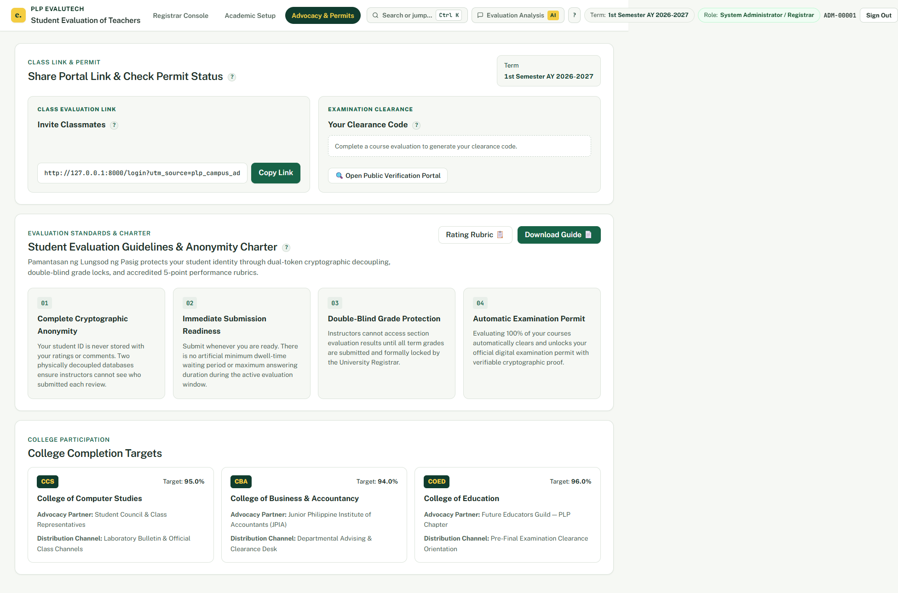

---

### #35: 5-Point Likert Rating Rubric Inspection Modal
- **Phase:** Phase 6: Admin Command
- **File:** [`37_admin_advocacy_rubric_modal.png`](screenshots/37_admin_advocacy_rubric_modal.png)
- **Description:** Transparent rubric descriptors from Outstanding (5) down to Poor (1).

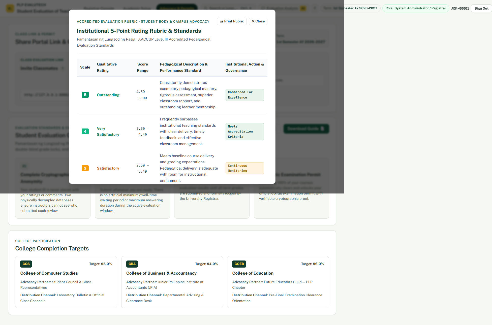

---

## 3. Institutional Governance & Security Verification

- **Zero Permits Policy Enforced:** The walkthrough confirms that the university tracks evaluation completion progress without issuing or gating examination permits.
- **Dual-Token Anonymity Guaranteed:** Zero student identifiers (`student_id`, `user_id`, `ip_address`) exist in the evaluation vault.
- **Double-Blind Grade Lock Validated:** Faculty reports remain locked until term grades are submitted and verified by the Registrar lock.
- **Accreditation Separation:** Campus facilities feedback (`TAG_UNCLASSIFIED`) is strictly separated from teaching pedagogy in the compiled Level III dossier.
